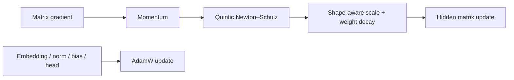
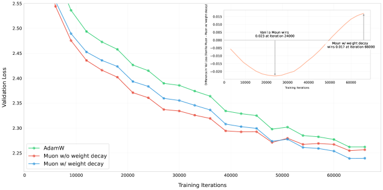

<!-- source-sha256: 6f7a6338775ac9249d187d7ab3568f75332aae9cc637aea45edbbfd232896a35 -->

[简体中文](README.md) · English

# Muon: An orthogonalizing optimizer for LLM hidden matrices

> **Core mechanism reproduction.** Muon updates two-dimensional hidden matrices; embeddings, norms, biases and output parameters retain AdamW.

## Paper information

| Field | Details |
| --- | --- |
| Paper | [arXiv 2502.16982](https://arxiv.org/abs/2502.16982) |
| Institution | Moonshot AI / UCLA |
| First public release | 2025-02-24 (arXiv v1) |
| Author code | Yes: [official author code](https://github.com/MoonshotAI/Moonlight). |
| Local adapter or method key | `muon` |
| Local reproduction code | [`src/auto_research/reproductions/muon/`](https://github.com/daiwk/auto-research/tree/main/src/auto_research/reproductions/muon/) |

## Original paper summary

### Background and main changes

AdamW updates matrix parameters as independent scalars. Muon treats hidden-layer gradients as matrices and approximates a polar decomposition with momentum and Newton–Schulz to obtain orthogonalized directions. The paper adds weight decay and shape-aware scaling for large-scale training. Parameters outside hidden matrices still use AdamW.



<!-- paper-figure:start -->
### Key figure from the paper

[](https://arxiv.org/html/2502.16982v1/x3.png)

> **Figure 2:** Overall design and components. From the [paper](https://arxiv.org/abs/2502.16982); copyright belongs to the authors. Click for the source.
<!-- paper-figure:end -->

### Core equations

$$
X_0=\frac{M_t}{\lVert M_t\rVert_F+\epsilon},\qquad
X_{k+1}=aX_k+b(X_kX_k^\top)X_k+c(X_kX_k^\top)^2X_k,
$$

Both the paper and local implementation use $a=3.4445,\ b=-4.7750,\ c=2.0315$, followed by weight decay and shape-aware scaling.

### Offline and online results

Scaling-law experiments report about `2×` compute efficiency over AdamW and train Moonlight 3B/16B MoE with 5.7T tokens. The production A/B gate does not apply to this LLM study.

## Local reproduction

> **Comparison:** Identical architecture, parameter count, data and 30-step budget; replace AdamW with Muon. WikiText-2 LM loss `5.7471→5.8016`, **+0.95%** (worse), with PPL **+5.61%**.

Mean orthogonality error of the Muon direction is `0.0335`, confirming the path executes. The short-budget, untuned-learning-rate negative result is retained. The optimizer is a separate Evolve genome axis for joint search. See [stable metrics](metrics/wikitext2-seed42.json).

```bash
auto-research reproduce --paper muon --dataset-dir data --seed 42
```

## Scope

No distributed optimizer state, communication optimizations, 3B/16B MoE or 5.7T-token compute frontier. This validates execution, not `2×` efficiency on small models.
