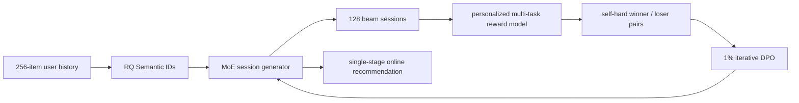
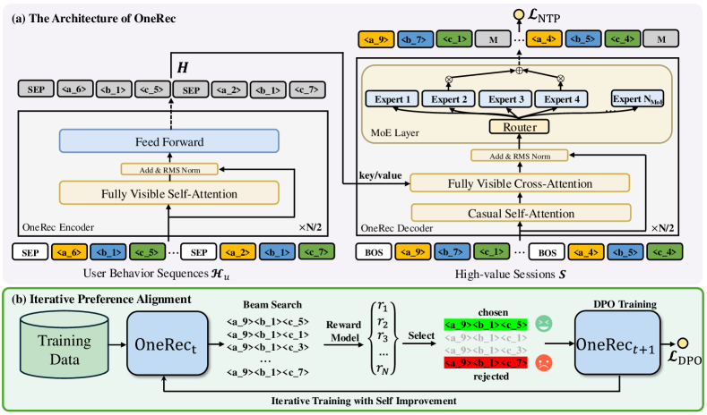

# OneRec: Session-wise generative recommendation with preference alignment

<!-- source-sha256: 83301159e4c5ecec138aa37c91753995d468affebf51c32739cadb286feeb293 -->

[简体中文](README.md)

> **Fidelity: Full core pipeline.** The code trains RQ Semantic IDs, a session-wise encoder–decoder, sparse MoE, a personalized reward model, and self-hard DPO, with smaller models, sessions, and public data.

## Paper information

| Field | Value |
| --- | --- |
| Paper link | [arXiv 2502.18965](https://arxiv.org/abs/2502.18965) |
| Organization | Kuaishou |
| First published | 2025-02-26 (arXiv v1) |
| Original author code | No official or author code was provided in the paper (checked 2026-08-09). |
| Adapter | `onerec` |
| Local reproduction code | [`src/auto_research/reproductions/onerec/`](https://github.com/daiwk/auto-research/tree/main/src/auto_research/reproductions/onerec/) |

## Original paper summary

### Background and main changes

Multistage retrieve–rank systems optimize separate objectives. Pointwise next-item generation also struggles to keep an entire session coherent and diverse. OneRec represents items with three-level RQ Semantic IDs, uses MoE to generate a full session of 5 target items, and trains a personalized reward model for watch and interaction metrics. Iterative Preference Alignment (IPA) chooses self-hard winners and losers from 128 beam-search sessions from the current model and uses just 1% of examples for iterative DPO.



<!-- paper-figure:start -->
### Key figure from the paper

[](https://ar5iv.labs.arxiv.org/html/2502.18965/assets/x2.png)

**Original Figure 2 (architecture):** Main modules and their connections. Image from the [original paper](https://arxiv.org/abs/2502.18965); copyright belongs to the authors. Click the image for its source.
<!-- paper-figure:end -->

### Core equations

OneRec concatenates the $L$-level SIDs of $m$ target items into a session and optimizes:

$$
\mathcal L_{NTP}=-\sum_{i=1}^{m}\sum_{j=1}^{L}\log P(s_i^{j+1}\mid s_{BOS},s_1^{1:L},\ldots,s_i^{1:j}).
$$

The reward model predicts SWT, VTR, WTR, and LTR for generated sessions. The IPA update uses:

$$
\mathcal L_{DPO}=-\log\sigma\left(\beta\log\frac{M_{t+1}(S^w\mid H)}{M_t(S^w\mid H)}-
\beta\log\frac{M_{t+1}(S^l\mid H)}{M_t(S^l\mid H)}\right).
$$

### Offline and online results in the paper

OneRec-1B reaches maximum SWT/LTR of 0.1529/0.0660 versus 0.1368/0.0579 for TIGER-1B. With IPA it reaches **0.1933/0.1203**. Compared with OneRec-1B, IPA improves max SWT and max LTR by 4.04% and 5.43%; using 1% DPO examples reaches about 95% of the best result at higher sampling rates.

Kuaishou uses 1% traffic for a strict A/B test on its main surface:

| Model | Total watch time | Average view duration |
|---|---:|---:|
| OneRec-0.1B | +0.57% | +4.26% |
| OneRec-1B | +1.21% | +5.01% |
| OneRec-1B + IPA | **+1.68%** | **+6.56%** |

## Local reproduction

> **Control:** Session-generator SFT versus OneRec with the reward model and self-hard DPO. NDCG@10 falls from 0.01565 to 0 (**-100%**). This ablates preference alignment; it is not a comparison with DIN.

MovieLens-1M trains a three-level RQ-VAE with SID codebooks `[256,128,64]`. The 96-dimensional, 2-layer encoder–decoder has 4 top-1 sparse experts and generates sessions of 3 items. The run performs 240 steps of session SFT and 120 steps of personalized reward modeling. From 12-beam sessions it selects 96 self-hard winner/loser pairs for 80 DPO steps. Test generation admits only catalog SID prefixes.

| Stage | Hit@10 | NDCG@10 | Head share@10 | Valid session |
|---|---:|---:|---:|---:|
| Session generator SFT | **0.0200** | **0.0157** | 0.4372 | 1.0000 |
| + iterative preference alignment | 0.0000 | 0.0000 | **0.1047** | 1.0000 |

SID uniqueness is **90.80%**. Final SFT loss is `5.1333`. Reward loss falls only from `0.6939` to `0.6804`, while DPO loss drops from `0.1358` to `0.00054`. Head share falls from 43.72% to 10.47%, but NDCG@10 also falls from `0.0157` to 0. The small reward model does not discriminate well enough and the policy over-optimizes it. **The local result rejects this DPO setup; it does not verify IPA gains.** The earlier heuristic `NDCG +28.78%` claim was withdrawn.

See [metrics/movielens-1m-seed42.json](metrics/movielens-1m-seed42.json). Full run:

```bash
pip install -e '.[neural-recs]'
AUTO_RESEARCH_ONEREC_CHECKPOINTS=runs/onerec-checkpoints/seed-42 \
auto-research reproduce --paper onerec --dataset-dir data --seed 42
```

Data, RQ-VAE, generator/reward checkpoints, and raw outputs stay in Git-ignored `data/` and `runs/`. The MR includes code, docs, and sanitized metrics only.
