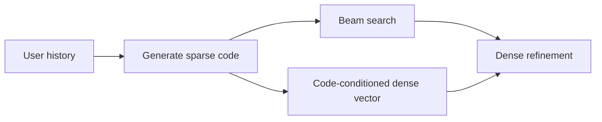
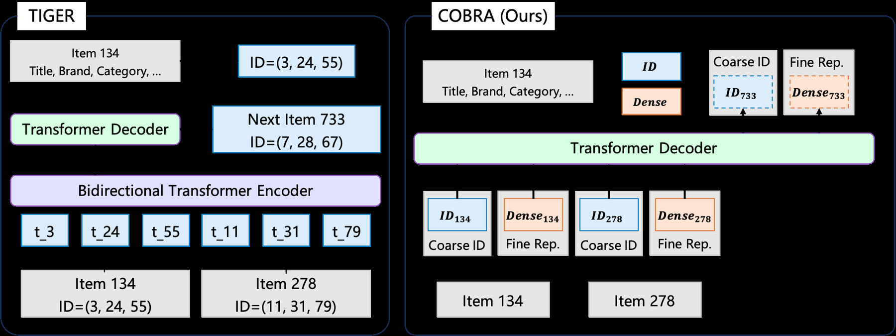

# COBRA: Cascaded sparse–dense generative retrieval

<!-- source-sha256: 930489811cd8b1dbbc5238be02e581ed862721a9a8b124b815ec3343d0e25f7c -->

[简体中文](README.md)

> Local sparse S-ID, conditional dense vector, joint training, and coarse-to-fine BeamFusion execute; no production ANN service.

## Paper information

| Field | Details |
|---|---|
| Paper | [arXiv 2503.02453](https://arxiv.org/abs/2503.02453) |
| Institution | Baidu. |
| First public release | 2025-03-04 (arXiv v1) |
| Author code | No official author code linked by the paper as checked on 2026-08-09. |
| Local adapter or method key | `cobra` |
| Local reproduction code | [`src/auto_research/reproductions/cobra/`](https://github.com/daiwk/auto-research/tree/main/src/auto_research/reproductions/cobra/) |

## Paper method and evidence

Quantizing to semantic IDs loses fine detail. Generate a sparse code, then condition an end-to-end trainable dense vector on it. Use beam search to find codes and refine retrieval by dense neighbors.

<!-- paper-figure:start -->
### Original paper figure

The original figure shows sparse-to-dense cascade retrieval. From the [original paper](https://arxiv.org/abs/2503.02453); copyright remains with the authors.
<!-- paper-figure:end -->

### Core equation

$L=L_{sparse}+\lambda L_{dense}$, with $L_{sparse}=-\sum_l\log p(c_l|h,c_{<l})$. Dense loss is full-catalog softmax between the conditional vector and target item. At inference $s(i)=s_{beam}(c_i)+\alpha q(c_i,h)^Tv_i$.

### Reported results

The paper beats purely generative and dense retrieval on public benchmarks. Baidu reports online conversion **+3.60%** and ARPU **+4.15%**, covering over 200 million daily active users.

## Local reproduction

180 users, 280 items, seeds 42–44. Shared DIN baseline (100 steps) Hit/NDCG **0.0481/0.02167**, COBRA **0.0593/0.02724**, or **+25.75%** relative NDCG. The distinct sparse-only → dense-cascade ablation is **+45.83%**; these comparisons are not interchangeable. Head share rises **0.0598→0.2313**, indicating higher popularity concentration. [Metrics](metrics/movielens-100k-seeds42-44.json).
