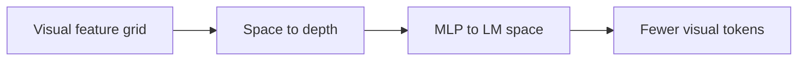
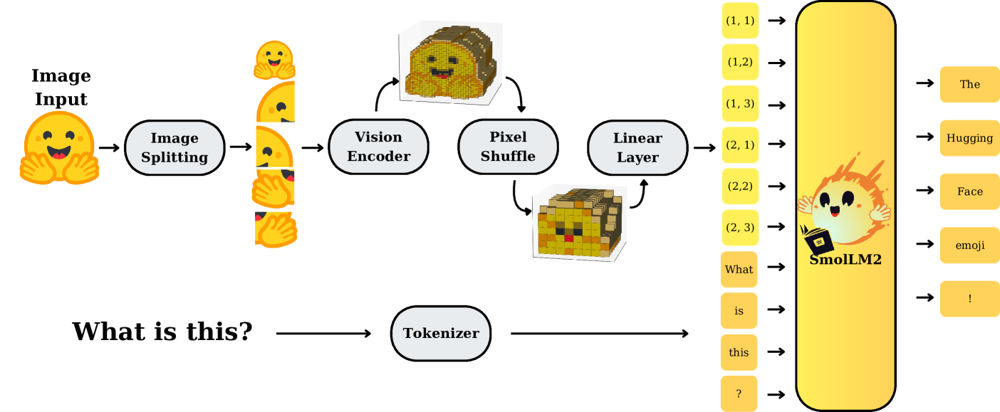

# SmolVLM: Visual token compression for small models

<!-- source-sha256: 1ed215d62a47b1fb810b58f77ce1c172d7bd6489664c3cf7f90f7dbd82a5a7b3 -->

[简体中文](README.md)

> Local pixel-shuffle compression and projection, not the full decoder or data recipe.

## Paper information

| Field | Details |
|---|---|
| Paper | [arXiv 2504.05299](https://arxiv.org/abs/2504.05299) |
| Institution | Hugging Face. |
| First public release | 2025-04-07 (arXiv v1) |
| Author code | [huggingface/smollm](https://github.com/huggingface/smollm). |
| Local adapter or method key | `smolvlm` |
| Local reproduction code | [`src/auto_research/reproductions/smolvlm/`](https://github.com/daiwk/auto-research/tree/main/src/auto_research/reproductions/smolvlm/) |

## Paper method and evidence

Move neighboring spatial tokens into channels with pixel shuffle, then project into LM space with an MLP. The paper also studies long contexts, image tiling, learned position tokens and data mixtures for 256M/500M/2.2B image/video models.



<!-- paper-figure:start -->
### Original paper figure

[](https://ar5iv.labs.arxiv.org/html/2504.05299/assets/x20.png)

The original figure shows the compact visual-language design. From the [original paper](https://arxiv.org/abs/2504.05299); copyright remains with the authors.
<!-- paper-figure:end -->

### Core equation

$$
X'_{h,w,:}=\operatorname{Concat}_{0\le i,j<r}X_{rh+i,rw+j,:},
\qquad |X'|=|X|/r^2.
$$

### Reported results

The paper reports under 1GB inference memory for 256M and better results than roughly 300× larger Idefics-80B; the 2.2B variant is competitive with larger VLMs on image/video tasks. No industrial A/B.

## Local reproduction

Mean-pooling linear connector vs `r=2` pixel shuffle + projector: test accuracy **46.8%→65.8% (+19.0 points)**, visual tokens **16→4 (-75%)**.

```bash
auto-research reproduce --paper smolvlm --dataset-dir data --seed 42
```

[Fixed metrics](metrics/fashion-mnist-qa-seed42.json). Real 32×32 clothing images with 2×2 space-to-depth; no high-res tiles, video sampling, 8k/16k context, learned position tokens or SmolLM decoder.
