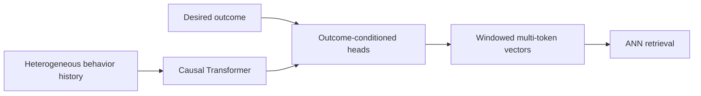
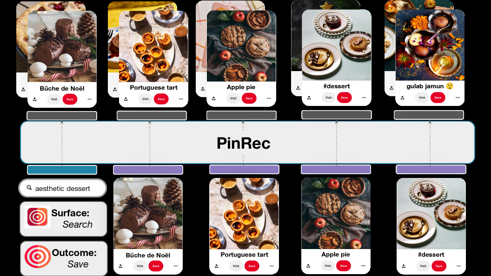

<!-- source-sha256: 5d7701ca7b7b55e8893b7e4aea32c02ecbeb37a6651b6fc01d56d288b9a3ceb1 -->

[简体中文](README.md) · English

# PinRec: Outcome-conditioned multi-token generative retrieval

> **Fidelity: full core pipeline.** Runs a causal decoder, outcome embeddings, normalized ANN outputs, and multi-token contrastive learning over an unordered future window. MovieLens rating buckets replace Pinterest's cross-surface actions.

## Paper information

| Field | Details |
| --- | --- |
| Paper | [arXiv 2504.10507](https://arxiv.org/abs/2504.10507) |
| Institution | Pinterest |
| First public release | 2025-04-09 (arXiv v1) |
| Author code | No official or author-released code found in the paper (checked 2026-08-09). |
| Local adapter or method key | `pinrec` |
| Local reproduction code | [`src/auto_research/reproductions/pinrec/`](https://github.com/daiwk/auto-research/tree/main/src/auto_research/reproductions/pinrec/) |

## Original paper summary

### Background and main changes

Conventional next-item prediction tends to continue a user's most common behavior, and strict ordering does not fit feed sessions. PinRec injects the desired outcome into the output head and generates several ANN-compatible item vectors at once for the same future window.



<!-- paper-figure:start -->
### Key figure from the paper

[](https://arxiv.org/html/2504.10507v7/x1.png)

> **Figure 1:** Overall design and components. From the [paper](https://arxiv.org/abs/2504.10507); copyright belongs to the authors. Click for the source.
<!-- paper-figure:end -->

### Core equations

$$
\hat i_{u,t}^{(k)}=\mathrm{norm}(O_k([h_t;e(a_{desired})])),\qquad
\mathcal L_{MT}=-\sum_k\log\frac{\exp(\hat i^{(k)}\cdot i^+_{\pi(k)}/\tau)}{\sum_j\exp(\hat i^{(k)}\cdot i_j/\tau)}.
$$

### Offline and online results

Paper Homefeed unordered Recall@10: UC 0.608, OC 0.625, MT+OC **0.676**. At 16 outputs, latency is about 10× lower than OC, recall +16%, and diversity +21.3%. Online MT+OC results are Fulfilled Sessions +0.28%, Time Spent +0.55%, and Homefeed Grid Clicks +3.33%. OC alone reaches up to **+4.01%** Grid Clicks.

## Local reproduction

> **Local comparison:** An unconditioned next-token baseline is compared with an outcome-conditioned three-token window. Unordered Recall@10 falls **27.78%** and NDCG@10 **34.82%**. This ablates outcome conditioning and multi-token generation, not a comparison against DIN.

| Model | Unordered Recall@10 | NDCG@10 |
|---|---:|---:|
| UC next-token | **0.00318 ± 0.00184** | **0.00132 ± 0.00085** |
| OC + 3-token window | 0.00230 ± 0.00061 | 0.00086 ± 0.00034 |

After one protocol correction and an increase from 160 to 200 steps, OC+MT still falls by 27.78% and 34.82% respectively. MovieLens supplies only sparse rating outcomes and two held-out future events, not Pinterest's multi-behavior window supervision. The negative result is not hidden by tuning. See [`metrics/movielens-100k-seeds42-44.json`](metrics/movielens-100k-seeds42-44.json).

```bash
for seed in 42 43 44; do AUTO_RESEARCH_PINREC_STEPS=200 auto-research reproduce --paper pinrec --dataset-dir data --seed "$seed"; done
```
