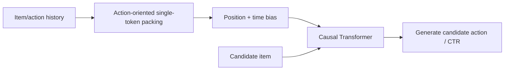
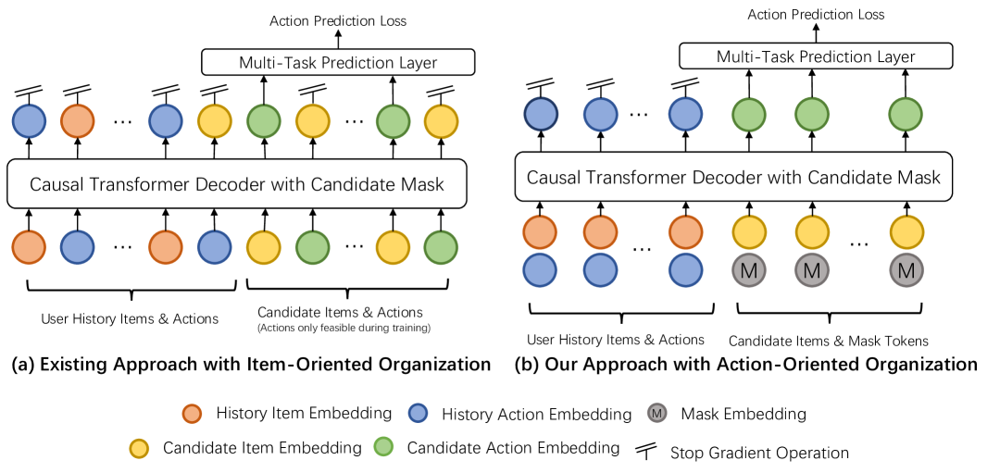

<!-- source-sha256: 21dc01ea1d9e56846d9a092360885c4b0ac70109eb1416798270727b64a897ff -->

[简体中文](README.md) · English

# GenRank: Generative action modeling for industrial ranking

> **Fidelity: full core pipeline.** Runs the interleaved item/action baseline, action-oriented packing, position/time biases, a causal Transformer, and action generation on scaled-down explicit MovieLens feedback.

## Paper information

| Field | Details |
| --- | --- |
| Paper | [arXiv 2505.04180](https://arxiv.org/abs/2505.04180) |
| Institution | Xiaohongshu |
| First public release | 2025-05-07 (arXiv v1) |
| Author code | No official or author-released code found in the paper (checked 2026-08-09). |
| Local adapter or method key | `genrank` |
| Local reproduction code | [`src/auto_research/reproductions/genrank/`](https://github.com/daiwk/auto-research/tree/main/src/auto_research/reproductions/genrank/) |

## Original paper summary

### Background and main changes

HSTU-style ranking interleaves items and actions, doubling the sequence length. GenRank uses actions as supervision or features for the same item token and adds position and time biases. This reduces ranking cost without dropping the multi-action generation objective.



<!-- paper-figure:start -->
### Key figure from the paper

[](https://ar5iv.labs.arxiv.org/html/2505.04180/assets/x2.png)

> **Figure 2:** The core architecture, its main modules, and their connections. From the [paper](https://arxiv.org/abs/2505.04180); copyright belongs to the authors. Click for the source.
<!-- paper-figure:end -->

### Core equations

$$
h_t=e(i_t)+e(a_t)+e(p_t)+e(\Delta t_t),\qquad
\mathcal L=-y\log\sigma(s)-(1-y)\log(1-\sigma(s)).
$$

### Offline and online results

In the paper's ablation, action-oriented packing speeds up execution by 78.7%, and position/time biases give a further 25.0% speedup. The reported combined gain is **94.8%**, with AUC +0.0006. A 15-day Xiaohongshu Explore Feed A/B test with 10% of users in each arm found Time Spent +0.3345%, Reads +0.6325%, Engagements **+1.2474%**, and LT7 +0.1481%.

## Local reproduction

> **Local comparison:** The baseline interleaves item and action tokens; the experimental arm uses GenRank action-oriented packing. Latency decreases **25.66%** but AUC declines **0.46%**. This compares sequence packing for efficiency and quality; it is neither an accuracy gain nor a DIN comparison.

| Model | AUC mean ± std | ms/example mean ± std |
|---|---:|---:|
| Interleaved item/action | **0.74282 ± 0.00997** | 0.15052 ± 0.08484 |
| GenRank action-oriented | 0.73939 ± 0.00228 | **0.11190 ± 0.00767** |

The shorter sequence yields **25.66%** lower latency but AUC −0.46%. This reproduces the efficiency mechanism, not the accuracy parity reported in the paper. See [`metrics/movielens-100k-seeds42-44.json`](metrics/movielens-100k-seeds42-44.json). Data, run artifacts, and checkpoints are not committed.

```bash
for seed in 42 43 44; do AUTO_RESEARCH_GENRANK_STEPS=120 AUTO_RESEARCH_GENRANK_TRAIN=8000 AUTO_RESEARCH_GENRANK_TEST=2000 auto-research reproduce --paper genrank --dataset-dir data --seed "$seed"; done
```
