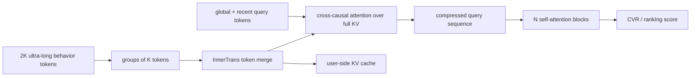
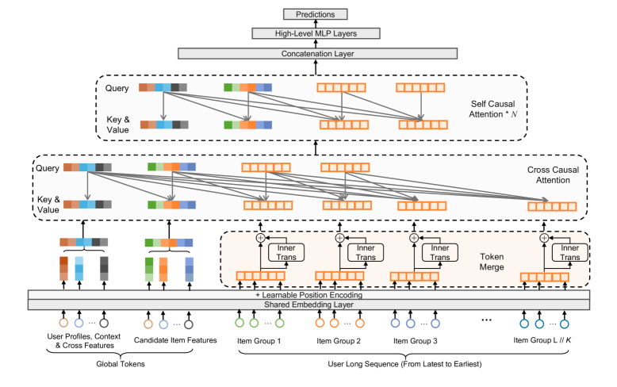

# LONGER: Ultra-long sequence modeling at ByteDance

<!-- source-sha256: e3c1167c41d992644a63b143c4d2b067a56b3e9329f4c49d07790cc45152ac4d -->

[简体中文](README.md)

> **Fidelity: Core mechanism.** The code trains InnerTrans grouping, global interest tokens, and hybrid attention end to end. ByteDance's private features, distributed training, and production serving are not reproduced.

## Paper information

| Field | Value |
| --- | --- |
| Paper link | [arXiv 2505.04421](https://arxiv.org/abs/2505.04421) |
| Organization | ByteDance / Douyin |
| First published | 2025-05-07 (arXiv v1) |
| Original author code | No official or author code was provided in the paper (checked 2026-08-09). |
| Adapter | `longer` |
| Local reproduction code | [`src/auto_research/reproductions/longer/`](https://github.com/daiwk/auto-research/tree/main/src/auto_research/reproductions/longer/) |

## Original paper summary

### Background and main changes

Industrial long-sequence models often rely on two-stage retrieval or truncation, introducing cross-stage inconsistency alongside $O(L^2)$ attention and GPU serving costs. LONGER adds a global token to stabilize the overall interest representation. A lightweight InnerTrans merges every K adjacent behaviors into a token. The first layer uses a few recent queries for cross-causal attention over full KV. Later layers self-attend only over compressed queries. Training uses mixed precision and activation recomputation; serving uses a per-user KV cache.

<!-- paper-figure:start -->
### Key figure from the paper

**Original Figure 1 (architecture):** Main modules and their connections. Image from the [original paper](https://arxiv.org/abs/2505.04421); copyright belongs to the authors. Click the image for its source.
<!-- paper-figure:end -->

### Core equations

Local merging is $M_i=TransformerBlock([e_i^1,\ldots,e_i^K])$. Global and recent queries form $O=[G;H_S]$. The first layer computes:

$$
Q=OW_Q,\quad K=RW_K,\quad V=RW_V,
$$

$$
Attention(Q,K,V)=Softmax(QK^T/\sqrt d+M)V.
$$

The ratio of attention FLOPs after merging is:

$$
\frac{FLOPs_{merge}}{FLOPs_{vanilla}}=\frac{6dK+L/K}{6d+L}.
$$

### Offline and online results in the paper

On 5.2B Douyin Ads CVR examples, LONGER achieves 0.85290 AUC and 0.47103 LogLoss, +1.57%/-3.39% relative to baseline. Using 100 recent queries takes about 54% of the FLOPs and approaches the 250-query result. KV caching reduces the serving throughput loss from about -40% to -6.8%.

| Online scenario | Metric 1 | Metric 2 |
|---|---:|---:|
| Douyin Ads Live | ADSS +1.063% | ADVV +1.168% |
| Douyin Ads Short Video | ADSS +2.097% | ADVV +2.151% |
| Douyin E-commerce Live | Order/U +7.9222% | GMV/U +6.5404% |
| Douyin E-commerce Short Video | Order/U +4.6125% | GMV/U +5.2771% |

## Local reproduction

> **Control:** The same embeddings, dimensions, optimizer, steps, and full-catalog evaluation. Adding InnerTrans, global tokens, and hybrid attention changes NDCG@10 by **-21.37%**. This is not a comparison with DIN.

On full public MovieLens-100K interactions, group size is 4. Trainable InnerTrans and attention pooling encode each group before hybrid Transformer attention over the result plus global and recent tokens. Three seeds train from scratch; test is not used for selection.

| Architecture | Hit@10 | NDCG@10 |
|---|---:|---:|
| Recent-sequence Transformer | **0.0057 ± 0.0013** | **0.0026 ± 0.0008** |
| LONGER hybrid attention | 0.0046 ± 0.0040 | 0.0020 ± 0.0017 |

NDCG@10 drops **21.37%** and variance is high. Under 90 training steps, longer history does not beat the recent baseline. This does not transfer the paper's production gains to MovieLens. The private long sequences, 5.2B examples, and GPU serving stack are not available. See [metrics/movielens-100k-seeds42-44.json](metrics/movielens-100k-seeds42-44.json).
