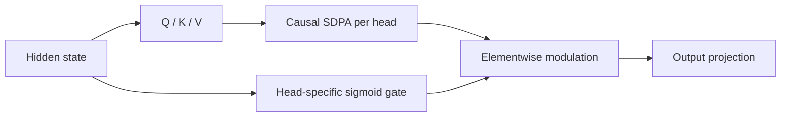
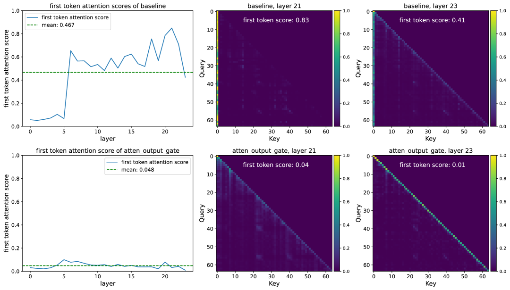

<!-- source-sha256: b54fd42633e645037c90e19956176ca9de6caea33c5dd7c9e022d9311f4e5a4d -->

[简体中文](README.md) · English

# Gated Attention: Per-head gating after SDPA

> **Core mechanism reproduction.** Trains the paper's best head-specific sigmoid gate and records the gate distribution.

## Paper information

| Field | Details |
| --- | --- |
| Paper | [arXiv 2505.06708](https://arxiv.org/abs/2505.06708) |
| Institution | Qwen / Alibaba |
| First public release | 2025-05-10 (arXiv v1) |
| Author code | Yes: [official author code](https://github.com/qiuzh20/gated_attention). |
| Local adapter or method key | `gated-attention` |
| Local reproduction code | [`src/auto_research/reproductions/gated_attention/`](https://github.com/daiwk/auto-research/tree/main/src/auto_research/reproductions/gated_attention/) |

## Original paper summary

### Background and main changes

Value aggregation through output projection in softmax attention is essentially linear. Of 30 variants, the paper finds that a query-dependent sigmoid gate after each head's SDPA is simple and stable. It adds nonlinearity and can sparsely suppress unhelpful heads.



<!-- paper-figure:start -->
### Key figure from the paper

[](https://ar5iv.labs.arxiv.org/html/2505.06708/assets/x2.png)

> **Figure 2:** Overall design and components. From the [paper](https://arxiv.org/abs/2505.06708); copyright belongs to the authors. Click for the source.
<!-- paper-figure:end -->

### Core equations

$$
a_{t,h}=\operatorname{SDPA}(q_{t,h},K_h,V_h),\qquad
\tilde a_{t,h}=\sigma(w_h^\top h_t+b_h)\,a_{t,h}.
$$

Large-scale ablation selects the post-SDPA gate rather than gates on scores, values or after output projection.

### Offline and online results

The authors train 1.7B dense and 15B MoE models on 3.5T tokens and compare 30 variants. Head-specific post-SDPA gating improves performance, stability, tolerance of larger learning rates and scaling, mitigates attention sinks, and improves long-context extrapolation. A production A/B gate does not apply to this LLM study.

## Local reproduction

> **Comparison:** Matched-budget `llama_modern` versus adding only a post-SDPA head-specific sigmoid gate. WikiText-2 LM loss `5.7471→5.7398`, **-0.13%** relative; PPL **-0.72%**.

The trained mean gate is `0.5358`; `22.80%` of gates fall below 0.5, so it is not an identity bypass. See [stable metrics](metrics/wikitext2-seed42.json).

```bash
auto-research reproduce --paper gated-attention --dataset-dir data --seed 42
```

## Scope

No 3.5T-token 1.7B/15B scaling study, full learning-rate sweep or long-context matrix was run. The local path trains the selected gate placement only.
