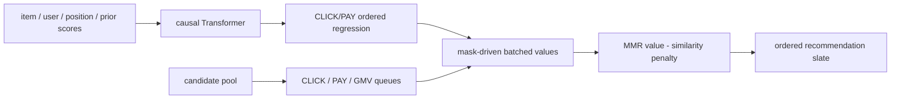
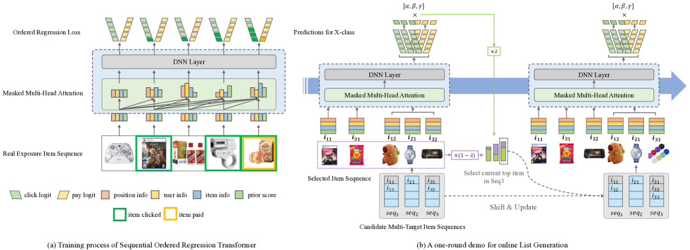

<!-- source-sha256: 995cb655764c84cc0860e0851c53c4941f8c0929cbe94fac18684659705377dd -->

[简体中文](README.md) · English

# SORT-Gen: List-level multi-objective generative reranking

> **Fidelity: core-mechanism reproduction.** Trains causal Transformer ordered regression and runs multi-objective queues, one mask-driven batched scoring call, and MMR. Private impressions and online kernels are scaled down or omitted.

## Paper information

| Field | Details |
| --- | --- |
| Paper | [arXiv 2505.07197](https://arxiv.org/abs/2505.07197) |
| Institution | Alibaba / Taobao & Tmall |
| First public release | 2025-05-12 (arXiv v1) |
| Author code | No official or author-released code found in the paper (checked 2026-08-09). |
| Local adapter or method key | `sort-gen` |
| Local reproduction code | [`src/auto_research/reproductions/sort_gen/`](https://github.com/daiwk/auto-research/tree/main/src/auto_research/reproductions/sort_gen/) |

## Original paper summary

### Background and main changes

Conventional formulas and LTR optimize item-level CTR, CVR, and GMV without modeling how an already selected prefix affects the next item. SORT-Gen supplies item, user, position, and upstream CTR/CVR scores to a causal Transformer. At each prefix position, ordered regression estimates whether the accumulated action count reaches each threshold $i$, giving the marginal list value of adding an item.

At inference, it builds objective queues such as CLICK, PAY, and GMV and reduces the search from all candidates to queue heads. Mask-Driven Fast Generation records selected items and queue state in tensor masks, evaluating several positions and queues in one batched call. MMR is part of selection rather than postprocessing diversity after generation.



<!-- paper-figure:start -->
### Key figure from the paper

[](https://ar5iv.labs.arxiv.org/html/2505.07197/assets/x1.png)

> **Figure 1:** The core architecture, its main modules, and their connections. From the [paper](https://arxiv.org/abs/2505.07197); copyright belongs to the authors. Click for the source.
<!-- paper-figure:end -->

### Core equations

$$
E_{\mathrm{input}}=E_{\mathrm{item}}\oplus E_{\mathrm{position}}\oplus E_{\mathrm{user}}\oplus E_{\mathrm{score}}.
$$

$$
\mathcal L(\theta)=\sum_{i=1}^{l}\sum_{j=1}^{l}\mathcal L_{i,j}^{\mathrm{CLICK}}+
\sum_{i=1}^{l}\sum_{j=1}^{l}\mathcal L_{i,j}^{\mathrm{PAY}},
$$

where binary target $(i,j)$ checks whether the cumulative action count of a prefix of length $j$ reaches $i$. Diversity selection is:

$$
\arg\max_{i_a\in Q\setminus S}\left[
\lambda V([S,i_a],S)-(1-\lambda)\max_{i_b\in S}\operatorname{SIM}(i_a,i_b)
\right].
$$

### Offline and online results

Versus the item-level greedy formula, SORT-Gen reports CLICK `+9.61%`, ORDER `+8.35%`, and GMV `+13.67%`. Versus the then fully deployed FFT Context-aware Model + fastDPP, CLICK is `+4.13%` and GMV `+8.10%`. Taobao's 10 Billion Subsidy A/B test ran two weeks at `19 ms` end-to-end latency, followed by deployment across multiple Taobao surfaces.

## Local reproduction

> **Local comparison:** The baseline strictly uses the item-level greedy formula with public click/pay/GMV priors weighted `5:1:1`. The experimental arm adds trained ordered regression, three queues, mask deduplication, and MMR to the same candidates and priors. Relative Click is `+5.10%`.

MovieLens-1M yields 4,742 training exposure slates, 210 validation slates, and 210 test slates; each selects 8 of 20 candidates. Loss drops `1.0724 → 0.4022`, and validation selects $\lambda=1.0$. Versus the formula baseline, local Click/slate `+5.10%`, Pay/slate `+8.46%`, GMV proxy `+9.00%`, and ILAD `+2.89%`. The generator makes one batched model call per slate. See [`metrics/movielens-1m-seed42.json`](metrics/movielens-1m-seed42.json).

```bash
auto-research reproduce --paper sort-gen --seed 42
```

## Scope

MovieLens ratings, genres, and popularity proxy clicks, transactions, content, and upstream scores. The run lacks real Taobao exposures, CVR/GMV, commercial user features, and multimodal embeddings. One batched PyTorch call is not the paper's 19 ms production kernel, and local proxy metrics are not directly comparable to online percentages.
