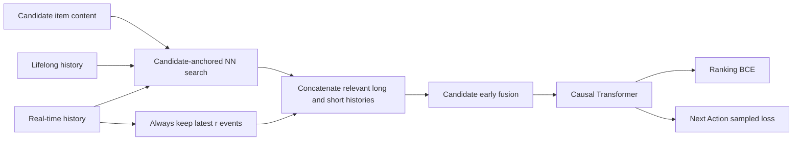
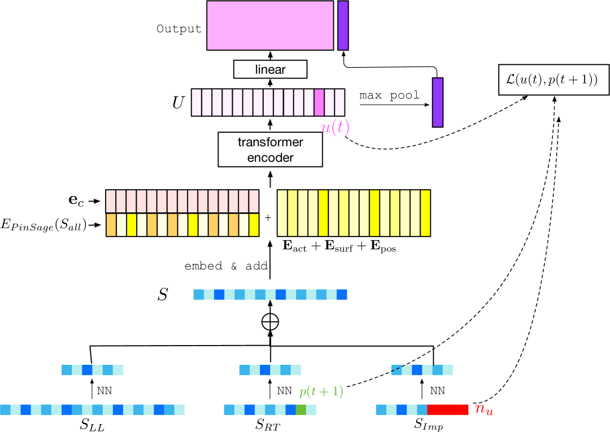

<!-- source-sha256: 1730abc050bdb1eed30824786ba0c4504cefc058cb759e4986e1c1b67a805ba6 -->

[简体中文](README.md) · English

# TransAct V2: Lifelong user action sequence modeling

> **Fidelity: core-mechanism reproduction.** Trains candidate-anchored long/short-history nearest-neighbor retrieval, recent-event retention, an early-fusion causal Transformer, and Next Action Loss. MovieLens genre substitutes for PinSage embeddings. Pinterest action/surface fields, impression negatives, and production Triton kernels are omitted.

## Paper information

| Field | Details |
| --- | --- |
| Paper | [arXiv 2506.02267](https://arxiv.org/abs/2506.02267) |
| Institution | Pinterest |
| First public release | 2025-06-02 (arXiv v1) |
| Author code | No official or author-released code found in the paper (checked 2026-08-09). |
| Local adapter or method key | `transact-v2` |
| Local reproduction code | [`src/auto_research/reproductions/transact_v2/`](https://github.com/daiwk/auto-research/tree/main/src/auto_research/reproductions/transact_v2/) |

## Original paper summary

### Background and main changes

TransAct primarily models about a hundred real-time actions, missing preferences formed over years. TransAct V2 retrieves candidate-relevant events from about $10^4$ lifelong actions, retains recent events, and ranks CTR with a shared Transformer. Next Action Loss makes the sequence representation predict the next positive interaction. The paper also includes serving optimizations such as SKUT and request deduplication; local reproduction focuses on the model pipeline.



<!-- paper-figure:start -->
### Key figure from the paper

[](https://ar5iv.labs.arxiv.org/html/2506.02267/assets/x2.png)

> **Figure 3:** The core architecture, its main modules, and their connections. From the [paper](https://arxiv.org/abs/2506.02267); copyright belongs to the authors. Click for the source.
<!-- paper-figure:end -->

### Core equations

For candidate $c$, retrieve from sequence $S$ as follows:

$$
NN(S,c)=\{S_i\mid i\in\operatorname{TopK}(E(S)e_c)\},
$$

$$
S_{all}=NN(S_{LL},c)\oplus S_{RT}[:r]\oplus NN(S_{RT}[r:],c).
$$

Next Action Loss uses sampled softmax on the user representation at time $t$, next positive $p_{t+1}$, and negative set $N_u$:

$$
L_{NAL}=-\sum_{u,t}\log\frac{e^{\langle u_t,p_{t+1}\rangle}}
{e^{\langle u_t,p_{t+1}\rangle}+\sum_{n\in N_u}e^{\langle u_t,n\rangle}},
\qquad L=L_{CTR}+w_{NAL}L_{NAL}.
$$

### Offline and online results

- Offline: relative to a non-sequence baseline, BST, TransAct, and TransAct V2 improve Repin HIT@3 by +6.04%/+7.74%/+13.31%, respectively. TransAct V2 reduces Hide HIT@3 by 11.25%.
- Online: 1.5% of Pinterest Homefeed traffic per arm. Against TransAct, Repin Volume +6.35%, Hide Volume -12.80%, Impression Diversity +0.45%, and App Time Spent +1.41%.
- Serving: for the production shapes, SKUT latency is −85.09% relative to PyTorch, with about 250× end-to-end p99 improvement. These kernel results were not reproduced on Mac.

## Local reproduction

> **Local comparison:** Parameter-matched TransAct is the baseline and TransAct V2 the experimental arm. NDCG@10 rises from 0.01277 to 0.02460 (**+92.65%**), with head share also up 14.70 percentage points. This is V2 versus V1, not against DIN.

MovieLens-100K downloads locally and has 932 valid users and 1,682 items. The experiment uses chronological leave-two-out and full-catalog ranking. Genre vectors replace PinSage content embeddings. Both models have 137,073 parameters; seeds 42/43/44 use 160 steps each on Apple MPS.

| Model | Hit@10 | NDCG@10 | Head share@10 |
|---|---:|---:|---:|
| TransAct | 0.02718 ± 0.00134 | 0.01277 ± 0.00114 | 0.84295 |
| TransAct V2 | 0.04936 ± 0.00175 | 0.02460 ± 0.00057 | 0.98995 |

TransAct V2 has **+92.65%** NDCG@10, but the share of popular items rises by 14.70 percentage points to nearly 99%. Public data confirms a relevance gain for candidate-related long history plus sampled-softmax NAL, while showing greater popularity bias at small scale. Both are part of the result.

See [metrics/movielens-100k-seeds42-44.json](metrics/movielens-100k-seeds42-44.json).

## Reproduction command

```bash
auto-research reproduce --paper transact-v2 --seed 42
```
