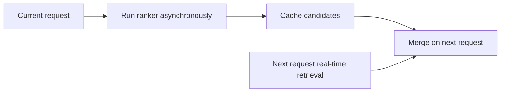
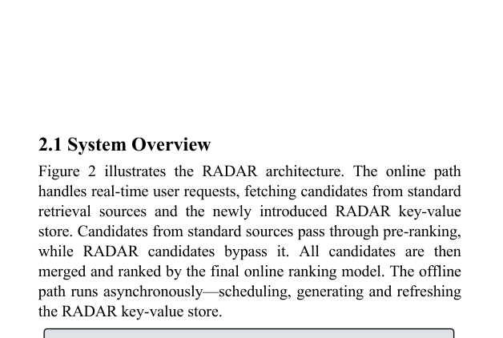

# RADAR: Recall Augmentation through Deferred Asynchronous Retrieval

<!-- source-sha256: e9dc35958ed9e1a43508851981fda451ee2a2a08df131adccd953b9efa402df5 -->

[简体中文](README.md)

> Core mechanism on public data, not production serving.

## Paper information

| Field | Details |
|---|---|
| Paper | [arXiv 2506.07261](https://arxiv.org/abs/2506.07261) |
| Institution | Meta. |
| First public release | 2025-06-08 (arXiv v1) |
| Author code | No official author code linked by the paper as checked on 2026-08-09. |
| Local adapter or method key | `radar` |
| Local reproduction code | [`src/auto_research/reproductions/radar/`](https://github.com/daiwk/auto-research/tree/main/src/auto_research/reproductions/radar/) |

## Paper method and evidence

Run a full ranker asynchronously after the current request. Cache its high-value items to supplement real-time retrieval on the next request.



<!-- paper-figure:start -->
### Original paper figure

[](https://arxiv.org/pdf/2506.07261#page=2)

The original figure shows deferred candidate retrieval. From the [original paper](https://arxiv.org/abs/2506.07261); copyright remains with the authors.
<!-- paper-figure:end -->

### Core equation

$$
C_{t+1}=R_{live}(h_{t+1})\cup\operatorname{TopK}(f_{rank}(h_t,\mathcal I)).
$$

### Reported results

The paper reports approximately doubled online Recall@200 and engagement +0.8%.

## Local reproduction

MovieLens-100K, 260 users/420 items, seed 42, full-catalog ranking. Shared transition + content versus adding RADAR only: NDCG@10 **0.0354→0.0344 (-2.78%)**. No private features, traffic, serving or kernels. The local decline is distinct from the online claim.

```bash
auto-research reproduce --paper radar --dataset-dir data --seed 42
auto-research evolve --model rankmixer --dataset movielens-100k --direction "Combine radar with installed paper operators" --generations 2 --population 4
```

[Fixed metrics](metrics/public-seed42.json).
