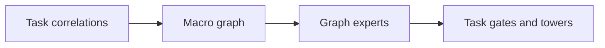
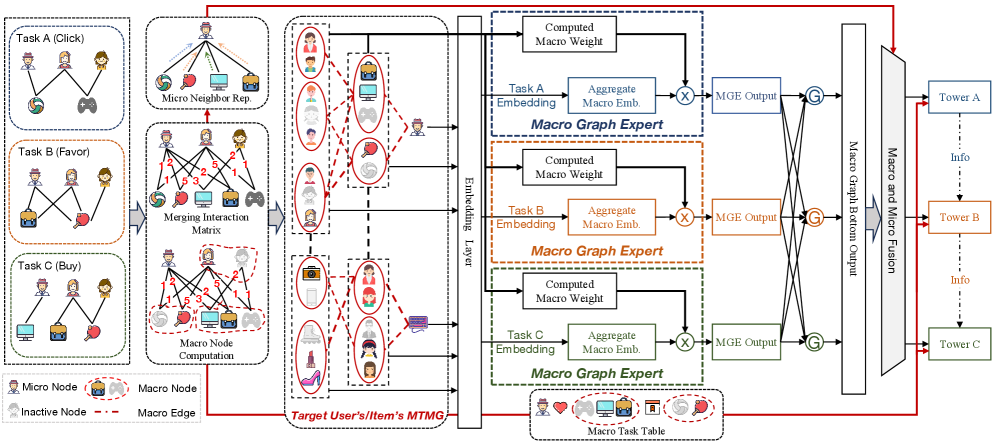

# MGOE: Macro Task Graph Experts

<!-- source-sha256: b10b55d78d5f4f23edcaf66beb54aa4acc56eee61076d441ce36614868a29205 -->

[简体中文](README.md)

> **Core mechanism evidence.** Paper and local evaluation are separate.

## Paper information

| Field | Value |
| --- | --- |
| Paper | [KDD 2026](https://arxiv.org/abs/2506.10520) |
| Affiliations | Alibaba |
| First public release | 2025-06-12 (arXiv v1) |
| Authors' code | [Author code](https://github.com/RainmannnnN/MGOE). |
| Adapter / method | `mgoe` |
| Local code | [`src/auto_research/reproductions/mgoe/`](https://github.com/daiwk/auto-research/tree/main/src/auto_research/reproductions/mgoe/) |

## Original paper

### Background and contribution

MMoE shares at example level but does not express stable inter-task structure. Build the Macro Task Merging Graph, propagate via graph bottom and experts, and predict with task towers.



<!-- paper-figure:start -->
### Key figure from the paper

[](https://arxiv.org/html/2506.10520v5/x2.png)

Original Figure 2: MGOE. From the [paper](https://arxiv.org/abs/2506.10520); copyright belongs to the authors. Not a local result.
<!-- paper-figure:end -->

### Core mechanism

$$
H^{l+1}=\sigma(\tilde A H^lW_l),\qquad
\hat y_t=\operatorname{Tower}_t\!\left(\sum_e g_{t,e}H_e\right).
$$

### Paper results

Public and Alibaba datasets outperform Shared-Bottom, MMoE, PLE, and MacGNN. Online versus MMoE: PCTR +2.16%, UCTR +1.63%, CVR +5.88%, GMV +16.46%, and stay time +4.12%.

## Local reproduction

Build three behavior/genre proxy tasks on MovieLens. Against separate MMoE gates: NDCG@10 0.07514→0.08042 (+7.03%), Hit@10 0.14048→0.15952, with increased head share. [Metrics](metrics/movielens-1m-seed42.json).

```bash
auto-research reproduce --paper mgoe --dataset-dir data --seed 42
```

## Reproduction limits

Actual graph estimation, propagation, and task gates, not billion-scale embeddings, distributed graph construction, or private online features.
