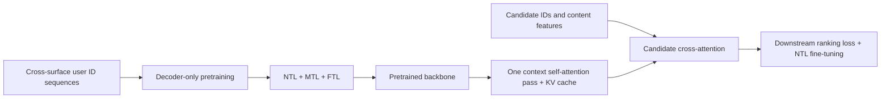
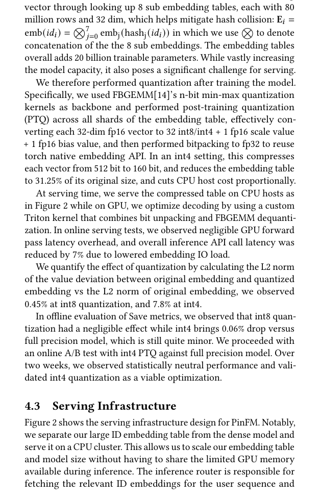

<!-- source-sha256: 1571dc6b29d21e3a71c3fdea34b383f03880748f186b759b415acaa48878273d -->

[简体中文](README.md) · English

# PinFM: Foundation model for user activity sequences

> **Fidelity: core-mechanism reproduction.** Runs NTL/MTL/FTL contrastive pretraining, downstream fine-tuning, candidate early fusion, Candidate ID Randomization, a lower backbone learning rate, and DCAT. It omits Pinterest's multi-action and cross-surface corpus, fresh-item age dropout, distributed 20B embeddings, int4, and Triton kernels.

## Paper information

| Field | Details |
| --- | --- |
| Paper | [arXiv 2507.12704](https://arxiv.org/abs/2507.12704) |
| Institution | Pinterest |
| First public release | 2025-07-17 (arXiv v1) |
| Author code | No official or author-released code found in the paper (checked 2026-08-09). |
| Local adapter or method key | `pinfm` |
| Local reproduction code | [`src/auto_research/reproductions/pinfm/`](https://github.com/daiwk/auto-research/tree/main/src/auto_research/reproductions/pinfm/) |

## Original paper summary

### Background and main changes

PinFM brings a foundation-model workflow to industrial recommendation: pretrain on cross-surface user actions, then fine-tune downstream rankers. Its decoder-only backbone learns next, multiple, and future tokens. Downstream candidate early fusion appends candidates to the user sequence. DCAT shares user history across candidates in one request, computing context self-attention once and cross-attending from each candidate to cached context KV.



<!-- paper-figure:start -->
### Key figure from the paper

[](https://arxiv.org/pdf/2507.12704#page=6)

> **Figure 2:** The core architecture, its main modules, and their connections. From the [paper](https://arxiv.org/abs/2507.12704); copyright belongs to the authors. Click for the source.
<!-- paper-figure:end -->

### Core equations

Pretraining representation:

$$
H=\phi_{out}\!\left(M\left(\phi_{in}(E_{item}+E_{action}+E_{surface})\right)\right).
$$

InfoNCE for one future item:

$$
\ell(H_i,z_j)=-\log\frac{e^{H_i^Tz_j/\tau}}
{e^{H_i^Tz_j/\tau}+\sum_k e^{H_i^Tz_k^-/\tau}}.
$$

$L_{NTL}$ predicts the next token, $L_{MTL}$ predicts a future window, and $L_{FTL}$ predicts the subsequent window from a fixed-length downstream position. DCAT computes and caches $K_u^l,V_u^l$ for deduplicated contexts. Candidate layers compute:

$$
X_c^l=g\!\left(Attn(Q_c^l,[K_u^l;K_c^l],[V_u^l;V_c^l]),X_c^{l-1}\right).
$$

The implementation retains this decomposition and reuses context KV during full-catalog evaluation rather than substituting a pooled Transformer.

### Offline and online results

- Offline Homefeed Save HIT@3: PinFM-base +2.91% and GraphSAGE-LT +3.76%. Adding CIR, age dropout, and GraphSAGE-LT yields +17.72% Save HIT@3 for items less than 28 days old.
- Online effects significant at 95% confidence: Homefeed sitewide/surface/fresh Saves +1.20%/+2.60%/+5.70%; I2I sitewide/surface Saves +0.72%/+2.09%.
- Efficiency: DCAT serving throughput +600%, training throughput +200%. int4 A/B results are neutral relative to full precision on business metrics. None of these infrastructure gains are claimed locally.

## Local reproduction and two iterations

> **Local comparison:** Scratch DCAT is the baseline and pretrained then fine-tuned PinFM is the experimental arm. The validation-selected setting has test NDCG@10 **-3.57%** and head share −55.40 percentage points. The incidental test +1.54% reported for the second round was not selected and is not the main result.

MovieLens-100K has 932 valid users and 1,682 items, with chronological leave-two-out splitting and full-catalog ranking. Both models have 165,426 parameters. Scratch DCAT goes straight to downstream training; PinFM pretrains with NTL+MTL+FTL, then fine-tunes with a 1/10 backbone learning rate. The run uses Apple MPS and seeds 42/43/44.

| Round | Pretrain / finetune | Validation result | Reported test NDCG change |
|---|---:|---|---:|
| 1 (selected) | 160 / 160 | PinFM 0.01318 vs scratch 0.01409 (−6.46%) | -3.57% |
| 2 | 240 / 320 | PinFM 0.01765 vs scratch 0.02020 (−12.66%) | +1.54% |

Second-round test table, as recorded:

| Model | Hit@10 | NDCG@10 | Head share@10 |
|---|---:|---:|---:|
| Scratch DCAT | 0.03004 ± 0.00303 | 0.01343 ± 0.00170 | 0.75569 |
| PinFM | 0.02682 ± 0.01139 | 0.01295 ± 0.00648 | 0.20165 |

Neither round verifies a validation relevance gain. The run selects the smaller 160/160 validation regression rather than choosing longer training by an incidental positive test number. The selected configuration has **-3.57%** test change and high variance, so there is no stable relevance gain. Head share drops 55.40 percentage points, showing that pretraining changes long-tail coverage substantially. MovieLens lacks the cross-surface, multi-action, hundred-million-ID corpus that drives transfer in the paper; additional steps risk overfitting, so iteration stopped.

See [metrics/movielens-100k-seeds42-44.json](metrics/movielens-100k-seeds42-44.json).

## Reproduction command

```bash
auto-research reproduce --paper pinfm --seed 42
```
