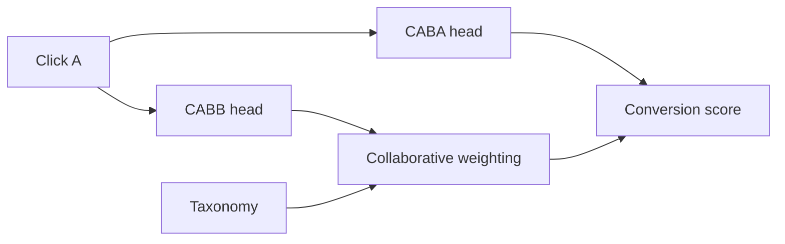
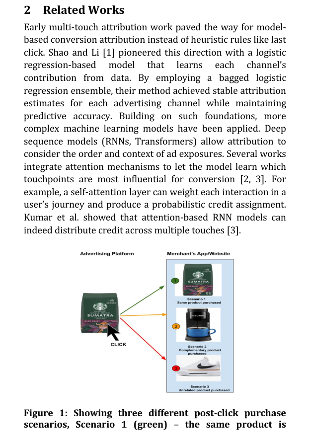

# Click A, Buy B: Cross-Item Conversion Attribution

<!-- source-sha256: 68bd4118c3f64ac38ec7c9dd8878927b87884d96c92b3b5c7fdbab22381a8262 -->

[简体中文](README.md)

> **Local core-mechanism evidence.** Paper outcomes and local results are separate.

## Paper information

| Field | Value |
| --- | --- |
| Paper | [arXiv 2507.15113](https://arxiv.org/abs/2507.15113) |
| Affiliations | Pinterest |
| First public release | 2025-07-20 (arXiv v1) |
| Authors' code | No official author code linked as of 2026-08-09. |
| Adapter / method | `click-a-buy-b` |
| Local code | [`src/auto_research/reproductions/click_a_buy_b/`](https://github.com/daiwk/auto-research/tree/main/src/auto_research/reproductions/click_a_buy_b/) |

## Original paper

### Background and contribution

Last click assumes the same item is clicked and bought. Separate click-A-buy-A and click-A-buy-B tasks, with taxonomy-based collaborative weights across items.



<!-- paper-figure:start -->
### Key figure from the paper

[](https://arxiv.org/pdf/2507.15113#page=2)

Original Figure 1: Click A, Buy B. From the [paper](https://arxiv.org/abs/2507.15113); copyright belongs to the authors. Not a local result.
<!-- paper-figure:end -->

### Core mechanism

$$
\hat p(B|A,u)=w_{AB}^{tax}\,\hat p_{\mathrm{CABB}}(B|A,u),\qquad
\mathcal L=\mathcal L_{\mathrm{CABA}}+\lambda\mathcal L_{\mathrm{CABB}}.
$$

### Paper results

The paper reports better offline cross-item attribution and +0.25% in the primary Pinterest online business metric.

## Local reproduction

Adjacent movies proxy click and buy. Versus single-item last click: NDCG@10 0.07514→0.10045 (+33.70%), Hit@10 0.14048→0.15714, head share 0.21762→0.14119. [Metrics](metrics/movielens-1m-seed42.json).

```bash
auto-research reproduce --paper click-a-buy-b --dataset-dir data --seed 42
```

## Reproduction limits

Watching consecutive movies is not a purchase. No real exposures, attribution window, auction, or Pinterest taxonomy.
