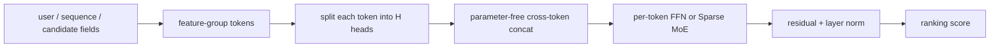
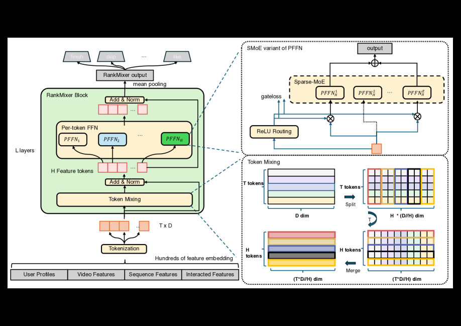

# RankMixer: Scaling industrial ranking with token mixing

<!-- source-sha256: 2ca7eabf43a432f34229ef9203891ead3c7274bf2a1c8487411e85bb49872fe9 -->

[简体中文](README.md)

> **Fidelity: Full core pipeline.** The local model executes parameter-free multi-head token mixing, per-token FFNs, ReLU-routed Sparse MoE, and dense training with sparse inference. Fields, parameter counts, and serving engineering are scaled down.

## Paper information

| Field | Value |
| --- | --- |
| Paper link | [arXiv 2507.15551](https://arxiv.org/abs/2507.15551) |
| Organization | ByteDance / Douyin |
| First published | 2025-07-21 (arXiv v1) |
| Original author code | No official or author code was provided in the paper (checked 2026-08-09). |
| Adapter | `rankmixer` |
| Local reproduction code | [`src/auto_research/reproductions/rankmixer/`](https://github.com/daiwk/auto-research/tree/main/src/auto_research/reproductions/rankmixer/) |

## Original paper summary

### Background and main changes

Conventional ranking feature crosses have low MFU; scaling parameters often increases latency. RankMixer groups heterogeneous fields into equal-width feature tokens and replaces self-attention with parameter-free head/token rearrangement. Each output token uses a separate FFN so frequent fields do not dominate shared parameters. The sparse version gives each token its own experts. A ReLU router and sparsity regularization allow different numbers of active experts per token. Dense training with sparse inference avoids under-training experts.



<!-- paper-figure:start -->
### Key figure from the paper

[](https://ar5iv.labs.arxiv.org/html/2507.15551/assets/x1.png)

**Original Figure 1 (architecture):** Main modules and their connections. Image from the [original paper](https://arxiv.org/abs/2507.15551); copyright belongs to the authors. Click the image for its source.
<!-- paper-figure:end -->

### Core equations

Token mixing:

$$
s^h=\operatorname{Concat}(x_1^h,\ldots,x_T^h),
$$

Per-token FFN:

$$
v_t=W_{t,2}\operatorname{GELU}(W_{t,1}s_t+b_{t,1})+b_{t,2},
$$

ReLU routing:

$$
G_{i,j}=\operatorname{ReLU}(h(s_i)_j),\qquad v_i=\sum_jG_{i,j}e_{i,j}(s_i).
$$

### Offline and online results in the paper

RankMixer-1B achieves up to about `+0.95%/+1.82%` Finish/Skip AUC over the production baseline offline. MFU increases from 4.5% to 45%. Full-traffic deployment reports Active Days `+0.3%` and app duration `+1.08%`.

## Local reproduction

> **Control:** Shared FFN versus dense per-token RankMixer and Sparse MoE. Dense improves NDCG@10 by approximately **+595.86%**, sparse by **+43.61%**. This is a token-FFN ablation; sparse does not match dense, so the dense result alone is not sufficient.

Four public tokens are genre profile, recent behavior, last behavior, and candidate. The setup uses 64 dimensions, 2 blocks, 4 experts, and 240 steps. All three variants use the same sampling and full-catalog test.

| Architecture | Parameters | Hit@10 | NDCG@10 | Head share@10 |
|---|---:|---:|---:|---:|
| Shared FFN | 181,121 | 0.0054 | 0.0020 | **0.0888** |
| Dense per-token RankMixer | 379,649 | **0.0247** | **0.0136** | 0.6262 |
| Sparse MoE RankMixer | 647,457 | 0.0075 | 0.0028 | 0.4171 |

Dense per-token isolation gives the best accuracy, supporting the direction of the core design. Sparse improves NDCG `43.61%` over shared but falls far short of dense and favors head items over shared. **The local ReLU/DTSI setup does not verify lossless sparsification.** Public data cannot verify MFU, kernel fusion, or quantized latency.

Structured metrics: [metrics/movielens-100k-seed42.json](metrics/movielens-100k-seed42.json).

```bash
pip install -e '.[neural-recs]'
auto-research reproduce --paper rankmixer --dataset-dir data --seed 42
```

Raw outputs stay in Git-ignored `runs/`.
