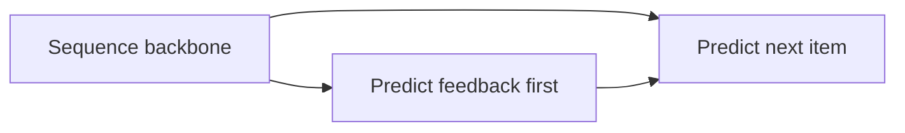
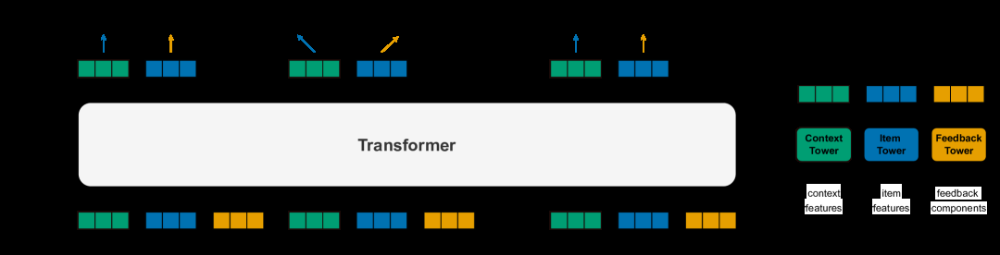

# ARGUS: Feedback–item factorization in a billion-parameter recommender Transformer

<!-- source-sha256: a8e69376692095761a43eae09f99dc06519c68209e297b83758fbb0c4d7754e5 -->

[简体中文](README.md)

> Core feedback-first/next-item-second factorization in a matched Transformer, not billion-parameter or private music reproduction.

## Paper information

| Field | Details |
|---|---|
| Paper | [arXiv 2507.15994](https://arxiv.org/abs/2507.15994) |
| Institution | Yandex. |
| First public release | 2025-07-21 (arXiv v1) |
| Author code | No official author code linked by the paper as checked on 2026-08-09. |
| Local adapter or method key | `argus` |
| Local reproduction code | [`src/auto_research/reproductions/argus/`](https://github.com/daiwk/auto-research/tree/main/src/auto_research/reproductions/argus/) |

## Paper method and evidence

Direct next-item prediction entangles the feedback type and item. Predict the feedback token first, then condition next-item prediction on it, allowing multiple feedback types to share a sequential backbone.

<!-- paper-figure:start -->
### Original paper figure

The original figure shows the factorized prediction path. From the [original paper](https://arxiv.org/abs/2507.15994); copyright remains with the authors.
<!-- paper-figure:end -->

### Core equation

$p(i_{t+1},f_{t+1}|h_t)=p(f_{t+1}|h_t)p(i_{t+1}|h_t,f_{t+1})$; train with $L=L_{item}+\lambda L_{feedback}$.

### Reported results

The paper scales to 1B parameters and reports about 18%/22% lower feedback/next-item NE. Yandex Music total listening time **+2.26%** and like likelihood **+6.37%**.

## Local reproduction

Shared evaluation on 180 users/280 items: DIN (100 steps) Hit/NDCG@10 **0.0481/0.02167**, ARGUS **0.0407/0.02077** (NDCG **-4.12%**). In the internal next-item-only ablation, NDCG drops **0.02628→0.02077 (-20.95%)** after adding feedback factorization, and Hit also falls. Neither comparison supports a gain. [Three-seed metrics](metrics/movielens-100k-seeds42-44.json).
