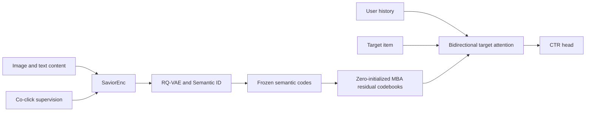
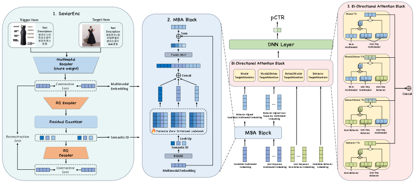

# SaviorRec: Adapting Semantic Cold-Start Features to a Changing Behavior Space

<!-- source-sha256: 1bc2993d1521b4c34564554d0c7a6e9187b979c61e6d8330dd3185930333d80d -->

[简体中文](README.md)

> **Fidelity: core mechanism.** Runs a behavior-supervised content encoder, residual-quantized Semantic IDs, zero-initialized MBA residual codebooks, bidirectional target/history attention, and CTR training. MovieLens genres replace private image/text features.

## Paper information

| Field | Details |
|---|---|
| Paper | [arXiv 2508.01375](https://arxiv.org/abs/2508.01375) |
| Organization | Alibaba |
| First public release | 2025-08-02 (arXiv v1) |
| Authors' code | No official or author implementation is linked by the paper (checked 2026-08-09). |
| Adapter / method | `saviorrec` |
| Local reproduction code | [`src/auto_research/reproductions/saviorrec/`](https://github.com/daiwk/auto-research/tree/main/src/auto_research/reproductions/saviorrec/) |

## Original paper

### Motivation and method

Cold-start ranking needs content semantics, but generic multimodal similarity differs from actual co-click and co-purchase behavior and the behavior distribution drifts. SaviorRec trains SaviorEnc on real interactions, quantizes features with RQ-VAE into Semantic IDs, and freezes SIDs for online ranking. Zero-initialized Modal-Behavior Alignment (MBA) codebooks learn residuals relative to current behavior. Bidirectional target/history attention feeds the CTR predictor.



<!-- paper-figure:start -->
### Key figure from the paper

[](https://ar5iv.labs.arxiv.org/html/2508.01375/assets/x1.png)

> **Figure 2:** Core architecture, its modules, and their connections. From the [original paper](https://arxiv.org/abs/2508.01375); copyright remains with the authors.
<!-- paper-figure:end -->

### Core equations

The content encoder is trained contrastively on positive behavior pairs; RQ quantizes the residual at each layer:

$$
z_i=E_{content}(x_i),\quad
c_i^l=\arg\min_k\|r_i^{l-1}-e_k^l\|^2,\quad
r_i^l=r_i^{l-1}-e_{c_i^l}^l.
$$

MBA preserves frozen SID and learns behavior residuals from zero-initialized codebooks:

$$
\tilde z_i=z_i+\sum_{l=1}^L A^l[c_i^l],\qquad A^l_0=0.
$$

The target queries history, which is also conditioned on the target, then predicts CTR:

$$
u_t=\operatorname{BiTargetAttn}(\{\tilde z_{h_j}\},\tilde z_t),\qquad
\hat y=\sigma(\operatorname{MLP}[u_t,\tilde z_t,u_t\odot\tilde z_t]).
$$

### Paper results

Overall AUC rises from **71.28%** to **72.11%**. Cold items with interaction counts in `[0,100)` rise from 70.34% to 71.87%. I2I Hit@30 rises from 28.56% with official semantic representations to 41.30% for the full method. Online cold-start A/B on Taobao's recommendation feed reports Clicks **+13.31%**, Orders **+13.44%**, and CTR **+12.80%**.

## Local reproduction

> **Local comparison.** Equal-budget Content Ranker versus SaviorRec. Overall AUC **+1.56%** and cold AUC **+6.92%** on average, but only one of three seeds improves for either metric. This ablates semantic–behavior alignment, not DIN.

MovieLens-100K genre multi-hot vectors are the public content modality, and nearby chronological interactions create behavior pairs. The first stage trains the content encoder and applies three-layer residual k-means; the second trains both methods on the same chronological CTR split. Cold test candidates are in the bottom training-frequency quartile.

| Method | AUC mean ± std | Cold AUC mean ± std | Seconds |
|---|---:|---:|---:|
| Content Ranker | 0.586787 ± 0.014785 | 0.459877 ± 0.054957 | **3.61** |
| SaviorRec | **0.595923 ± 0.009095** | **0.491690 ± 0.083339** | 6.50 |

Relative mean gains are not stable. Final MBA L2 norms of 0.80–0.88 across all three seeds show the zero-initialized residual actually trains. See [results](metrics/movielens-100k-seeds42-44.json).

```bash
pip install -e '.[neural-recs]'
for seed in 42 43 44; do
  AUTO_RESEARCH_SAVIOR_ENCODER_STEPS=160 AUTO_RESEARCH_SAVIOR_STEPS=180 \
  auto-research reproduce --paper saviorrec --dataset-dir data --seed "$seed"
done
```

No original images or Taobao production features are present; local AUC is not directly comparable to the paper. Data, run outputs, and checkpoints are not committed.
