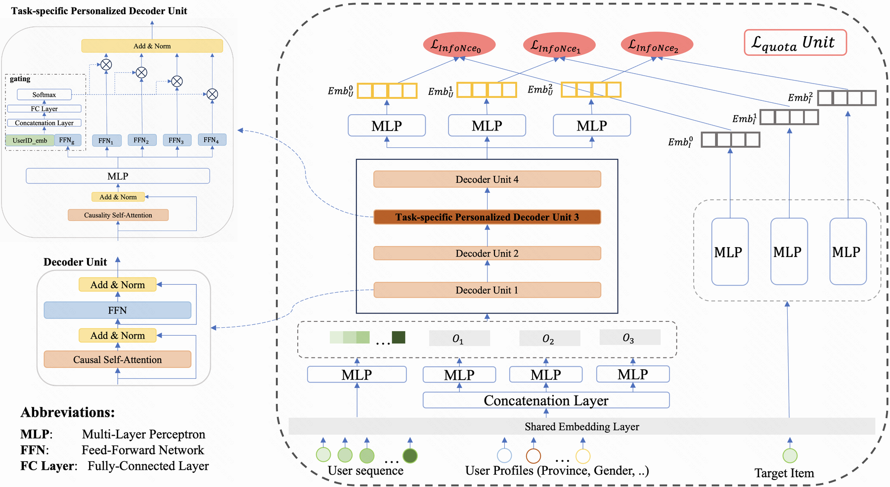

# MPFormer: Adaptive Framework for Industrial Multi-Task Personalized Sequential Retriever

<!-- source-sha256: 6962a5e6c4a969615e7b40f8f75e51ee79b38df20095ab42dbb933aecacf35ed -->

[简体中文](README.md)

> Core public multi-task retrieval mechanism.

## Paper information

| Field | Details |
|---|---|
| Paper | [Paper or original source](https://arxiv.org/abs/2508.20400) |
| Institution | Kuaishou Technology. |
| First public release | 2025-08-28 (arXiv v1) |
| Author code | No official author code linked by the paper as checked on 2026-08-09. |
| Local adapter or method key | `mpformer` |
| Local reproduction code | [`src/auto_research/reproductions/mpformer/`](https://github.com/daiwk/auto-research/tree/main/src/auto_research/reproductions/mpformer/) |

## Paper method and evidence

Objective tokens drive one sequential retriever across behaviors. Allocate capacity and retrieval quota dynamically by task difficulty.


<!-- paper-figure:start -->
### Original paper figure

[](https://ar5iv.labs.arxiv.org/html/2508.20400/assets/mpformer_model1_update.png)

Figure shows objective-driven retrieval. From the [original paper](https://arxiv.org/abs/2508.20400); copyright remains with the authors.
<!-- paper-figure:end -->

### Core equation

$$
z_m=F([e_m;h]),\quad\mathcal L=\sum_m q_m(h)\mathcal L_m,\quad\sum_mq_m=1.
$$

### Reported results

Kuaishou reports watch time +0.426%, training resources -60%, serving resources -66.7%.

## Local reproduction

MovieLens-100K full catalog, 260 users/420 items, seed 42: shared transition+content baseline versus MPFormer, NDCG@10 **0.0354→0.0329 (-7.15%)**. [Fixed metrics](metrics/public-seed42.json). No private logs, traffic, checkpoints or production serving; local results do not reproduce paper lift.

```bash
auto-research reproduce --paper mpformer --dataset-dir data --seed 42
auto-research evolve --model rankmixer --dataset movielens-100k --direction "Combine mpformer with installed paper operators" --generations 2 --population 4
```
