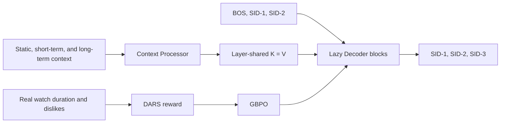
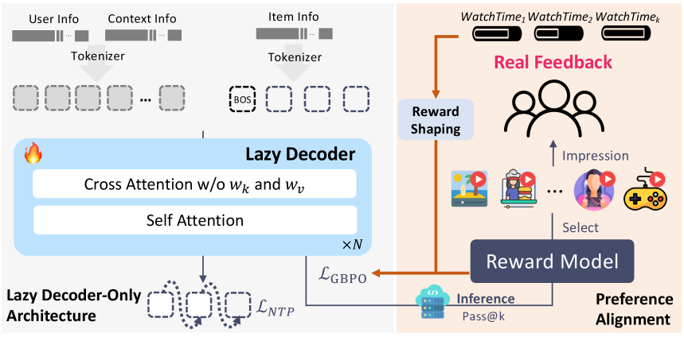

# OneRec-V2: Lazy Decoder and Reinforcement Learning from Real Feedback

<!-- source-sha256: b05b43f1da164d07e635f87a76fa99d95a232a1dbb1a2c1ad8e01b069b6ceb6c -->

[简体中文](README.md)

> **Fidelity: full core pipeline.** The implementation trains three-level residual-quantized Semantic IDs, newest-impression SFT, the layer-shared K/V Lazy Decoder, Duration-Aware Reward Shaping, and GBPO. It reduces model and data scale and omits private heterogeneous features and distributed serving.

## Paper information

| Field | Details |
|---|---|
| Paper | [arXiv 2508.20900](https://arxiv.org/abs/2508.20900) |
| Organization | Kuaishou |
| First public release | 2025-08-28 (arXiv v1) |
| Authors' code | No official or author implementation is linked by the paper (checked 2026-08-09). |
| Adapter / method | `onerec-v2` |
| Local reproduction code | [`src/auto_research/reproductions/onerec_v2/`](https://github.com/daiwk/auto-research/tree/main/src/auto_research/reproductions/onerec_v2/) |

## Original paper

### Motivation and method

OneRec-V1 generates recommendation sessions with an encoder-decoder, repeatedly encoding long histories and relying on a separate reward model for alignment. V2 supervises only the newest impression. A Context Processor computes one set of K/V for all decoder layers, and the target path decodes only `[BOS,s1,s2]→[s1,s2,s3]`. Lazy blocks apply cross-attention, causal self-attention, and an FFN in order, with GQA, K=V, and cross-layer KV sharing. Post-training uses actual watch duration and negative feedback. DARS corrects duration bias, and GBPO controls positive and negative gradients with dynamic denominators rather than PPO clipping.



<!-- paper-figure:start -->
### Key figure from the paper

[](https://ar5iv.labs.arxiv.org/html/2508.20900/assets/x3.png)

> **Figure 2:** Core architecture, its modules, and their connections. From the [original paper](https://arxiv.org/abs/2508.20900); copyright remains with the authors.
<!-- paper-figure:end -->

### Core equations

Newest-impression SFT supervises the three SID levels for the last item only:

$$
\mathcal L_{SFT}=-\sum_{l=1}^{3}\log\pi_\theta(s_l\mid C,s_{<l}).
$$

DARS buckets videos by duration and computes watch-duration percentiles within each user and bucket:

$$
F(d)=\lfloor\log_\beta(d+\epsilon)\rfloor,\qquad
A_i=\begin{cases}+1&q_i\ge 75\%\\-1&\text{explicit dislike}\\0&\text{otherwise.}\end{cases}
$$

GBPO uses separate dynamic denominators for positive and negative advantage:

$$
\mathcal L_{GBPO}=-\mathbb E\left[\frac{\pi_\theta(y\mid x)}{D(y,A)}A\right],
$$

$$
D=\begin{cases}\max(\pi_{old},\mathrm{sg}(\pi_\theta))&A>0\\
\max(\pi_{old},1-\mathrm{sg}(\pi_\theta))&A<0.\end{cases}
$$

### Paper results

At 1B parameters, Lazy Decoder loss is 3.27 versus 3.28/3.26 for standard encoder-decoders. Compute falls from 296.36/204.21 GFLOPs to **18.89 GFLOPs**. GQA and KV sharing leave loss almost unchanged.

The one-week online A/B used **5% of traffic on each of Kuaishou and Kuaishou Lite**:

| Product | App stay | Watch time | Like | Follow | Forward |
|---|---:|---:|---:|---:|---:|
| Kuaishou | +0.467% | +1.367% | +3.924% | +4.730% | +3.183% |
| Kuaishou Lite | +0.741% | +0.762% | +5.393% | +5.627% | **+7.958%** |

## Local reproduction

> **Local comparison.** Relative to the encoder-decoder, Lazy SFT has **-54.78%** latency and **-0.34%** validation loss. Relative to Lazy SFT, GBPO yields **+21.66%** feedback-weighted probability. These are separate efficiency and alignment ablations, not comparisons with DIN or a unified NDCG metric.

The first run downloads KuaiRand-Pure (~45 MB compressed, ~194 MB extracted); data are not committed. Public tags, authors, and duration, with a fixed identity projection in place of private multimodal embeddings, train three residual k-means SID layers `[128,64,32]` with **98.52%** unique codes. From 60,000 real standard-feed events the experiment constructs 12,000 chronological newest-impression examples. The 64-dimensional, two-layer model runs 80 SFT and 40 GBPO steps.

Three-seed summary:

| Metric | Encoder-decoder | Lazy SFT | Lazy + GBPO |
|---|---:|---:|---:|
| Validation loss | 12.0533 ± 0.0451 | **12.0121 ± 0.0039** | — |
| ms / example | 0.2632 ± 0.0617 | **0.1190 ± 0.0193** | — |
| Feedback-weighted probability | — | 1.281e-5 ± 0.110e-5 | **1.558e-5 ± 0.272e-5** |

Lazy inference is **54.78%** faster locally with validation loss 0.34% lower, supporting similar quality at substantially lower compute. Mean feedback-weighted probability rises **21.66%** with GBPO, but individual seeds give +29.23% / -0.46% / +35.38%, so the direction is not stable. The probability also depends on SID space size and is not directly comparable to online percentages. See [structured results](metrics/kuairand-pure-seeds42-44.json).

```bash
pip install -e '.[neural-recs]'
for seed in 42 43 44; do
  AUTO_RESEARCH_ONEREC_V2_SFT_STEPS=80 \
  AUTO_RESEARCH_ONEREC_V2_GBPO_STEPS=40 \
  AUTO_RESEARCH_ONEREC_V2_EVENTS=60000 \
  AUTO_RESEARCH_ONEREC_V2_EXAMPLES=12000 \
  auto-research reproduce --paper onerec-v2 --dataset-dir data --seed "$seed"
done
```
