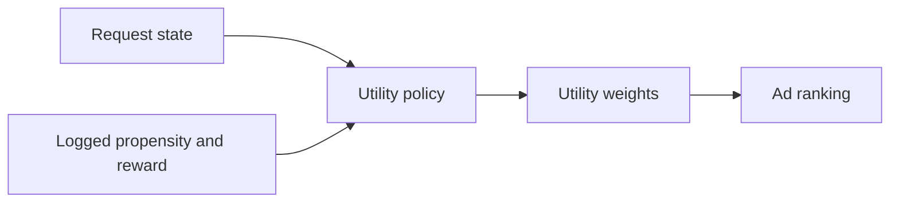
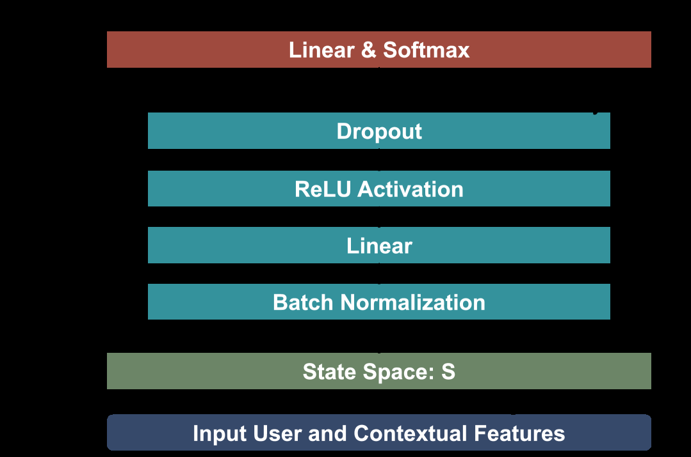

# DRL-PUT: Reinforcement Learning for Ranking Utility Weights

<!-- source-sha256: db3a5e07580d4a802619930ba3bbeb49a460f534ff273d08eba86960cb03a26c -->

[简体中文](README.md)

> **Local core-mechanism evidence.** Paper outcomes and local results are separate.

## Paper information

| Field | Value |
| --- | --- |
| Paper | [arXiv 2509.05292](https://arxiv.org/abs/2509.05292) |
| Affiliations | Pinterest |
| First public release | 2025-09-05 (arXiv v1) |
| Authors' code | No official author code linked as of 2026-08-09. |
| Adapter / method | `drl-put` |
| Local code | [`src/auto_research/reproductions/drl_put/`](https://github.com/daiwk/auto-research/tree/main/src/auto_research/reproductions/drl_put/) |

## Original paper

### Background and contribution

Treat a utility-weight combination as the action. Condition on request/user state and learn from logged propensities and aggregate rewards instead of manually tuning relevance, CTR, CVR, and revenue weights.



<!-- paper-figure:start -->
### Key figure from the paper

[](https://ar5iv.labs.arxiv.org/html/2509.05292/assets/x1.png)

Original Figure 1: DRL-PUT. From the [paper](https://arxiv.org/abs/2509.05292); copyright belongs to the authors. Not a local result.
<!-- paper-figure:end -->

### Core mechanism

$$
U(i|x,a)=\sum_m a_m s_m(i,x),\qquad
\nabla J=\mathbb E\!\left[\frac{\pi(a|x)}{\mu(a|x)}
(R-b)\nabla\log\pi(a|x)\right].
$$

### Paper results

Offline policy/value metrics filter candidates. Production Revenue +0.27%, CTR +1.62%, CVR +0.67%, with segment guardrails reported separately.

## Local reproduction

Versus fixed utility: NDCG@10 0.07514→0.08951 (+19.13%), Hit@10 0.14048→0.15714, head share 0.21762→0.11048. [Metrics](metrics/movielens-1m-seed42.json).

```bash
auto-research reproduce --paper drl-put --dataset-dir data --seed 42
```

## Reproduction limits

Public ratings proxy clicks/revenue, not auctions, real counterfactual rewards, or advertiser constraints.
