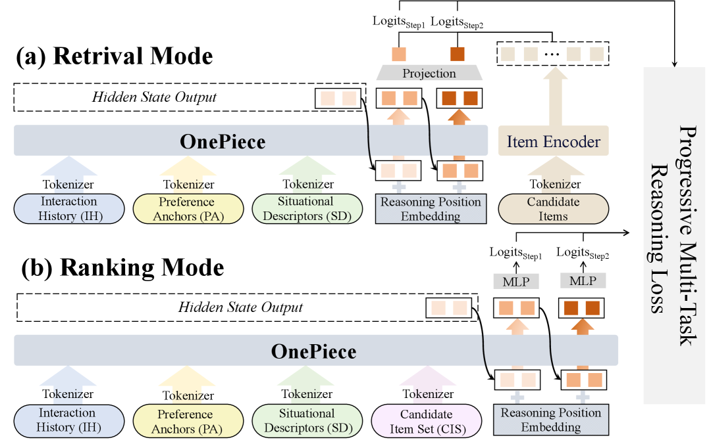

# OnePiece: Bringing Context Engineering and Reasoning to Industrial Cascade Ranking

<!-- source-sha256: 52b4c28411ef5a4ad4b067023fc649ab59f6c33dd76690da3c2ef8c9aaa92e3c -->

[简体中文](README.md)

> **Fidelity: core mechanism.** Paper results, public-data measurements, and omissions are separate.

## Paper information

| Field | Details |
|---|---|
| Paper | [arXiv 2509.18091](https://arxiv.org/abs/2509.18091) |
| Organization | Shopee |
| First public release | 2025-09-22 (arXiv v1) |
| Authors' code | The paper did not provide official or author code when checked on 2026-08-09. |
| Adapter / method | `onepiece` |
| Local reproduction code | [`src/auto_research/reproductions/onepiece/`](https://github.com/daiwk/auto-research/tree/main/src/auto_research/reproductions/onepiece/) |

## Original paper

### Motivation and method

Combine context tokens, block-level latent reasoning, and progressive multitask objectives in a cascade ranker. Retrieval, clicks, and value share representations but converge in stages.


<!-- paper-figure:start -->
### Key figure from the paper

[](https://ar5iv.labs.arxiv.org/html/2509.18091/assets/x2.png)

> **Figure 2:** Core architecture, modules, and connections. From the [original paper](https://arxiv.org/abs/2509.18091); copyright remains with the authors.
<!-- paper-figure:end -->

### Core equations

$$
H^{k+1}=H^k+F_k(H^k,c),\quad\mathcal L=\sum_t\alpha_t(k)\mathcal L_t.
$$

### Paper results

Shopee reports GMV/UU above +2% and ad revenue +2.90%.

## Local reproduction

> **Local comparison:** The baseline is the shared transition + content scorer. Adding only the OnePiece core mechanism changes NDCG@10 by +22.87% relative.

MovieLens-100K, 260 users and 420 items, seed 42: NDCG@10 0.0354 → **0.0435 (+22.87%)**.

```bash
auto-research reproduce --paper onepiece --dataset-dir data --seed 42
auto-research evolve --model rankmixer --dataset movielens-100k --direction "组合 onepiece 与已安装论文算子" --generations 2 --population 4
```

See the [fixed metrics](metrics/public-seed42.json).

## Reproduction boundaries

Full-catalog MovieLens-100K exercises the paper's core state, objective, or inference path. No private features, production traffic, or online serving are used. Paper A/B results are cited separately and local numbers do not represent the original large model, data, traffic, or custom kernels.
