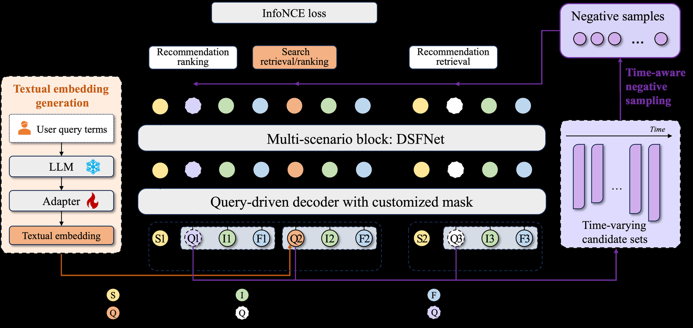

# IntSR: An Integrated Generative Framework for Search and Recommendation

<!-- source-sha256: 328790c19bd660ec836002451243ca165ff09ab2690b3f5e46b3f17a30423555 -->

[简体中文](README.md)

> Public full-catalog core mechanism, not production serving.

## Paper information

| Field | Details |
|---|---|
| Paper | [Paper or original source](https://arxiv.org/abs/2509.21179) |
| Institution | Alibaba / Amap. |
| First public release | 2025-09-25 (arXiv v1) |
| Author code | No official author code linked by the paper as checked on 2026-08-09. |
| Local adapter or method key | `intsr` |
| Local reproduction code | [`src/auto_research/reproductions/intsr/`](https://github.com/daiwk/auto-research/tree/main/src/auto_research/reproductions/intsr/) |

## Paper method and evidence

Use explicit queries and implicit session intent to generate POIs/items from one search-and-recommendation vocabulary. Temporal context represents intent drift.


<!-- paper-figure:start -->
### Original paper figure

[](https://ar5iv.labs.arxiv.org/html/2509.21179/assets/Figures/Overall_framework.png)

Figure shows unified search and recommendation generation. From the [original paper](https://arxiv.org/abs/2509.21179); copyright remains with the authors.
<!-- paper-figure:end -->

### Core equation

$$
p(i|q,h,t)=\sum_zp(i|z,t)p(z|q,h),\quad\mathcal L=-\log p(i^+|q,h,t).
$$

### Reported results

Amap reports GMV +9.34% and POI CTR +2.76%.

## Local reproduction

MovieLens-100K, 260 users/420 items, seed 42: shared transition+content baseline vs IntSR NDCG@10 **0.0354→0.0473 (+33.56%)**.

```bash
auto-research reproduce --paper intsr --dataset-dir data --seed 42
auto-research evolve --model rankmixer --dataset movielens-100k --direction "Combine intsr with installed paper operators" --generations 2 --population 4
```

[Fixed metrics](metrics/public-seed42.json). No private features, production traffic or serving. These local public-data results do not reproduce online lift.
