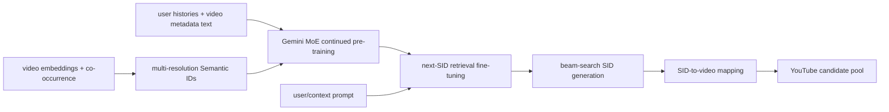
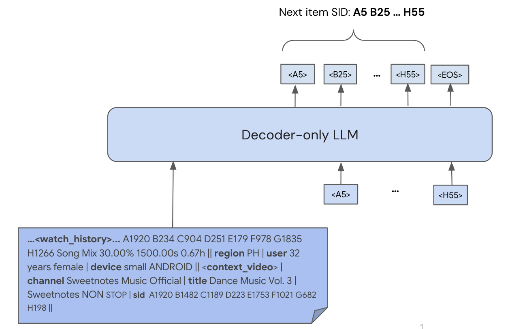

# PLUM: Pre-trained LLM for industrial generative retrieval

<!-- source-sha256: de259821d86608e733121f2600883623a95018edea0410ab4f1418c19cad4aed -->

[简体中文](README.md)

> **Fidelity: Full core pipeline** The local reproduction runs multilayer RQ Semantic IDs, continued pretraining of a pretrained decoder-only LM, next-SID SFT, and token-level constrained beam search. It scales down the model and data and substitutes public modalities for private ones.

## Paper information

| Field | Value |
| --- | --- |
| Paper link | [arXiv 2510.07784](https://arxiv.org/abs/2510.07784) |
| Organization | Google DeepMind / YouTube |
| First published | 2025-10-09 (arXiv v1) |
| Original author code | No official or author code was provided in the paper (checked 2026-08-09). |
| Adapter | `plum` |
| Local reproduction code | [`src/auto_research/reproductions/plum/`](https://github.com/daiwk/auto-research/tree/main/src/auto_research/reproductions/plum/) |

## Original paper summary

### Background and main changes

A conventional large embedding model (LEM) puts most parameters in ID embedding tables with tens of millions of entries; the neural network remains relatively small and does not scale like an LLM. PLUM initializes from Gemini-1.5 MoE and quantizes videos to Semantic IDs (SIDs). Continued pretraining (CPT) uses user behavior and video text, ASR, and channel metadata. Next-SID generation is then fine-tuned for retrieval. At serving time, beam search generates candidate SIDs directly, without a dot-product retrieval index.



<!-- paper-figure:start -->
### Key figure from the paper

[](https://arxiv.org/html/2510.07784v1/gen_retrieval.png)

**Original Figure 2 (overview):** The overall design and its main components. Image from the [original paper](https://arxiv.org/abs/2510.07784); copyright belongs to the authors. Click the image for its source.
<!-- paper-figure:end -->

### Core equations

Residual quantization constructs SIDs level by level. For $r_i^1=e_i$, the level-$l$ code and residual are:

$$
s_i^l=\arg\min_k\|r_i^l-c_k^l\|_2^2,\qquad r_i^{l+1}=r_i^l-c_{s_i^l}^l.
$$

SID-v2 jointly trains reconstruction, RQ commitment/codebook, and co-occurrence contrastive losses:

$$
\mathcal L_{SID}=\mathcal L_{recon}+\sum_l\left(\beta\|r_l-\mathrm{sg}[e_l]\|_2^2+\|\mathrm{sg}[r_l]-e_l\|_2^2\right)+\lambda\mathcal L_{con}.
$$

Progressive masking samples a depth $r\in[1,L]$ per example and reconstructs only from the sum of the first $r$ codewords to strengthen the hierarchy.

CPT uses an autoregressive objective over mixed tokens. Retrieval SFT uses the target video's SID:

$$
\mathcal L_{retrieval}=-\sum_{l=1}^{L}\log P(s_{click}^l\mid prompt,s_{click}^{<l}).
$$

The method moves capacity from an $O(|V|d)$ ID table to scalable Transformer/MoE parameters and aligns language and collaborative representations through CPT.

### Offline and online results in the paper

Against the production LEM, the 900M-activated-parameter MoE reports LFV/Shorts effective vocabulary of 2.60×/13.24× and CTR ratios of 1.42×/1.33×. SIDv2 increases uniqueness from 94.0% to 96.7% and Video Recall@10 from 12.3% to 14.4% over SIDv1. 8th-day Recall@10 rises from 0.19 with random initialization and no CPT to **0.28** with LLM initialization and CPT.

The YouTube live experiment adds PLUM candidates to the existing pool and gives LEM+ the same additional quota:

| Metric | LFV | Shorts |
|---|---:|---:|
| Engaged users | +0.07% | +0.28% |
| Panel CTR | +0.76% | +4.96% |
| Views | +0.80% | +0.39% |
| Satisfaction | +0.06% | +0.39% |

## Local reproduction

> **Control:** R1 is randomly initialized without CPT; CR1 is randomly initialized with CPT. Recall@10 is 0.0050 for both (**0.00%**), while final SFT loss drops from 3.5023 to 2.5933. The LLM-initialized R2 and CR2 both have zero recall. This verifies CPT convergence, not a DIN comparison or a final retrieval gain.

The old score-fusion proxy is no longer used. The MovieLens-1M run executes:

1. RQ-VAE training with hashed TF-IDF titles and genres as public content modalities, and adjacent views as contrastive positives.
2. Three codebooks of sizes `[512, 256, 128]`, progressive masking, and a separate tokenizer SID token for every codeword.
3. CPT with exactly 50% behavior sequences and 50% SID plus title/genre metadata.
4. Full-parameter SmolLM2-135M training without LoRA, with the paper's R1/R2/CR1/CR2 ablations.
5. SFT with all prompt loss masked; cross-entropy covers only the next item's three SID tokens and the end token.
6. Token-level beam search with a catalog trie constraining valid successors, not full-catalog item score fusion.

The clean runs use 240 CPT steps, 240 SFT steps, batch size 16, constant LR `1e-4`, beam size 10, and the same 200 test users. `1e-4` matches the approximately 110M setting in Table 6. A `5e-5` trial was stopped because it converged substantially more slowly in the same stage and was excluded from the four-way comparison.

### Local results

| Variant | LLM init | CPT | CPT final loss | SFT final loss | Recall@10 | NDCG@10 |
|---|:---:|:---:|---:|---:|---:|---:|
| R1 | no | no | — | 3.5023 | **0.0050** | 0.0019 |
| R2 | yes | no | — | 3.7209 | 0.0000 | 0.0000 |
| CR1 | no | yes | 2.6366 | **2.5933** | **0.0050** | **0.0050** |
| CR2 | yes | yes | 2.7961 | 3.1686 | 0.0000 | 0.0000 |

Three-level SID uniqueness is **98.33%** and all four constrained runs have **100%** valid SIDs. With random initialization, CPT lowers final SFT loss from 3.5023 to 2.5933 but leaves Recall@10 at 0.0050. With LLM initialization, recall is zero with and without CPT, so the paper's initialization gain was not reproduced.

One hit among 200 users equals 0.005 Recall. At this coarse resolution, **the experiment verifies better convergence with CPT, but not higher final recall from CPT or LLM initialization**. The former `NDCG@10 +24.62%` claim was withdrawn because it came from heuristic fusion, not PLUM. See [metrics/movielens-1m-seed42.json](metrics/movielens-1m-seed42.json).

An early continuation from 240 to 1,000 steps is excluded: its checkpoint did not save `semantic_ids.npy`, and rebuilding the SID map changed uniqueness from 98.33% to 98.54%, so token meanings could not be guaranteed stable. The implementation now saves the SID map with the model and requires it when resuming. The table retains only the clean run before that drift.

A 135M dense LM replaces Gemini-1.5 MoE, MovieLens titles and genres replace YouTube text, ASR, and multimodal embeddings, and training uses roughly thousands of optimizer steps instead of 260B CPT tokens. The SID training, CPT, SFT, and generative inference stages remain in place.

### Full local command

```bash
python3 -m venv .auto-research/plum-venv
source .auto-research/plum-venv/bin/activate
pip install -e '.[plum]'

AUTO_RESEARCH_PLUM_CHECKPOINTS=runs/plum-checkpoints/seed-42 \
auto-research reproduce \
  --paper plum \
  --dataset-dir data \
  --output-dir runs/reproductions \
  --seed 42
```

The defaults match the table: 240 CPT steps, 240 SFT steps, batch 16, and 200 evaluation users. MovieLens-1M downloads on first use. Checkpoints, data, and raw runs stay in ignored `.auto-research/`, `runs/`, and `data/` directories. The MR contains code, tests, structured metrics, and conclusions only.

For a longer clean experiment, start from scratch with an empty checkpoint directory rather than resuming the old run:

```bash
AUTO_RESEARCH_PLUM_SFT_STEPS=1000 \
AUTO_RESEARCH_PLUM_CHECKPOINTS=runs/plum-checkpoints/seed-42-sft1000-clean \
auto-research reproduce --paper plum --dataset-dir data --seed 42
```

The following smaller configuration checks only the pipeline and is not evidence for a formal result:

```bash
AUTO_RESEARCH_PLUM_CPT_STEPS=1 \
AUTO_RESEARCH_PLUM_SFT_STEPS=1 \
AUTO_RESEARCH_PLUM_EVAL_USERS=2 \
auto-research reproduce --paper plum --seed 42
```
