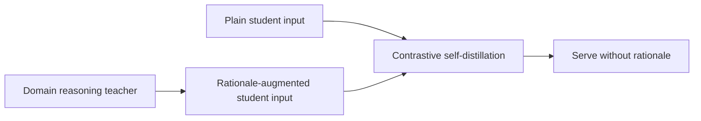
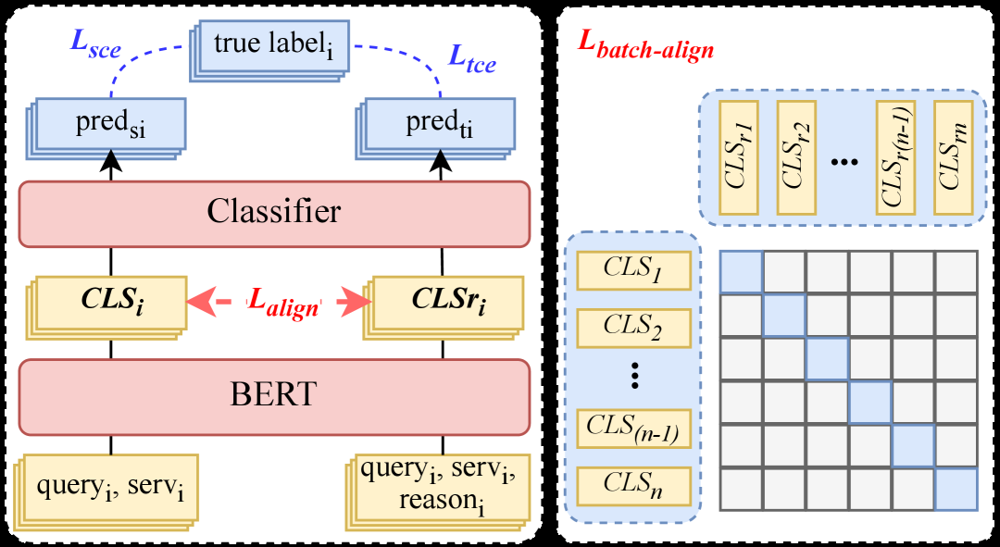

# CRSD: From Reasoning LLMs to BERT, a Two-Stage Distillation Framework for Search Relevance

<!-- source-sha256: c90a11801ab74fa7759db411c35fa8344a268bf11ef7df7c63c78b242ad481ab -->

[简体中文](README.md)

> Public-data core mechanism, not private serving reproduction.

## Paper information

| Field | Details |
|---|---|
| Paper | [TheWebConf 2026 Industry](https://arxiv.org/abs/2510.11056) |
| Institution | Meituan. |
| First public release | 2025-10-13 (arXiv v1) |
| Author code | No official author code linked by the paper as checked on 2026-08-09. |
| Local adapter or method key | `crsd` |
| Local reproduction code | [`src/auto_research/reproductions/crsd/`](https://github.com/daiwk/auto-research/tree/main/src/auto_research/reproductions/crsd/) |

## Paper method and evidence

Build a domain reasoning LLM with continued pretraining, supervised fine-tuning and multidimensional preference optimization. Contrastively self-distill between plain and rationale-augmented inputs to the same lightweight student, eliminating the reasoning chain at serving.



<!-- paper-figure:start -->
### Original paper figure

[](https://ar5iv.labs.arxiv.org/html/2510.11056/assets/x3.png)

The original figure shows the two distillation stages. From the [original paper](https://arxiv.org/abs/2510.11056); copyright remains with the authors.
<!-- paper-figure:end -->

### Core equation

$$
\mathcal L=\mathcal L_{label}+\lambda D_{KL}(p_s(\cdot|x,r)\Vert p_s(\cdot|x))+\gamma\mathcal L_{con}.
$$

### Reported results

Meituan search ads at 30% traffic: AdCTR +0.91%, AdCVR +1.06%, GTV +0.40%, and bad-case rate down 30.5 percentage points.

## Local reproduction

Shared transition + content baseline versus CRSD changes only the core mechanism. MovieLens-100K full-catalog NDCG@10 **0.0354 → 0.0346 (-2.14%)**. [Fixed metrics](metrics/public-seed42.json).

```bash
auto-research reproduce --paper crsd --dataset-dir data --seed 42
```

The local distillation experiment does not use private logs or production serving; local and online metrics are separate.
