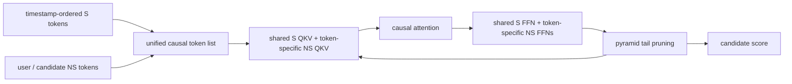
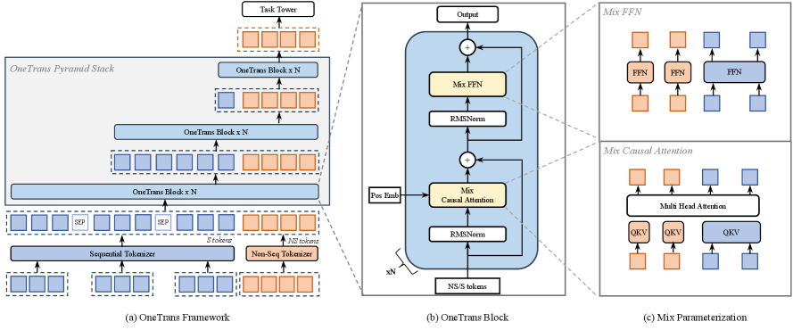

<!-- source-sha256: 190630d280daef94d9670e235ee65c62a78ae093fbf3adaae016986b309b53e2 -->

[简体中文](README.md) · English

# OneTrans: One causal Transformer for sequence and feature interaction

> **Fidelity: full core pipeline.** Runs unified S/NS tokenization, mixed QKV, mixed FFN, causal attention, and pyramid tail pruning. Persistent cross-request KV serving is not reproduced.

## Paper information

| Field | Details |
| --- | --- |
| Paper | [arXiv 2510.26104](https://arxiv.org/abs/2510.26104) |
| Institution | ByteDance |
| First public release | 2025-10-30 (arXiv v1) |
| Author code | No official or author-released code found in the paper (checked 2026-08-09). |
| Local adapter or method key | `onetrans` |
| Local reproduction code | [`src/auto_research/reproductions/onetrans/`](https://github.com/daiwk/auto-research/tree/main/src/auto_research/reproductions/onetrans/) |

## Original paper summary

### Background and main changes

OneTrans puts behavioral S-tokens before heterogeneous NS-tokens and uses one causal Transformer for sequence modeling and field interactions. Semantically homogeneous S-tokens share QKV and FFN weights; each NS-token has independent parameters. Causal order lets NS-tokens read the whole history. The pyramid stack retains only recent S queries at each layer. Production reuses S-side computation through cross-candidate and cross-request KV caching.



<!-- paper-figure:start -->
### Key figure from the paper

[](https://ar5iv.labs.arxiv.org/html/2510.26104/assets/x2.png)

> **Figure 2:** The core architecture, its main modules, and their connections. From the [paper](https://arxiv.org/abs/2510.26104); copyright belongs to the authors. Click for the source.
<!-- paper-figure:end -->

### Core equations

$$
X^{(0)}=[S\text{-tokens};NS\text{-tokens}],
$$

$$
W_i^{Q,K,V}=\begin{cases}W_S^{Q,K,V}&i\le L_S\\W_{NS,i}^{Q,K,V}&i>L_S,\end{cases}
$$

$$
X^{(n)}=\operatorname{MixedFFN}(\operatorname{Norm}(Z^{(n)}))+Z^{(n)}.
$$

### Offline and online results

OneTrans-L versus DCNv2+DIN: CTR AUC/UAUC `+1.53%/+2.79%` and CVR AUC/UAUC `+1.14%/+3.23%`. Online Feeds order/U `+4.3510%`, GMV/U `+5.6848%`, and p99 latency `-3.91%`; Mall GMV/U `+3.6696%`.

## Local reproduction

> **Local comparison:** Encode-then-Interact uses a separate sequence encoder before candidate interactions. OneTrans raises NDCG@10 from 0.0069 to 0.0154 (**+123.58%**), but head share reaches 92%. This is a unified versus stacked architecture ablation, not a DIN comparison.

MovieLens-100K uses 64 dimensions, 2 layers, 32 S-tokens, 2 NS-tokens, 240 steps, and three seeds. The baseline encodes sequence independently before interacting with candidate features.

| Architecture | Hit@10 | NDCG@10 | Head share@10 |
|---|---:|---:|---:|
| Encode then interact | 0.0154 ± 0.0043 | 0.0069 ± 0.0022 | 0.3374 |
| OneTrans | **0.0304 ± 0.0035** | **0.0154 ± 0.0034** | 0.9200 |

Relative NDCG is `+123.58%`, but **92.0%** of recommendations come from the popularity top 10%. The unified causal block learns a strong popularity shortcut on this small public dataset. The result verifies trainability and a directional lift, not the paper's generalization quality. A future run should add sampled-popularity correction or richer user/item/context fields.

See [metrics/movielens-100k-seed42.json](metrics/movielens-100k-seed42.json).

```bash
auto-research reproduce --paper onetrans --dataset-dir data --seed 42
```

Raw runs stay in Git-ignored `runs/`.
