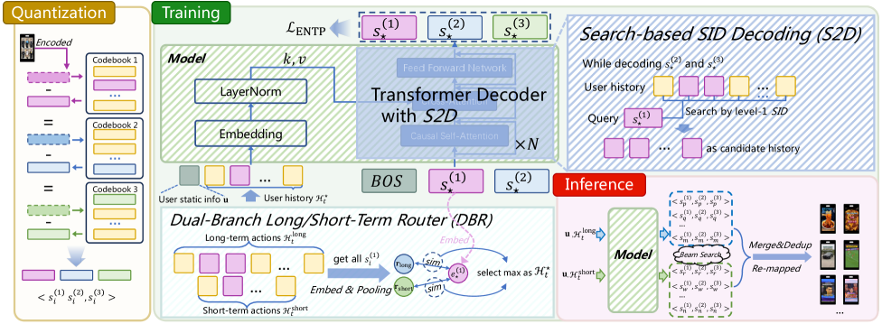

# DualGR: Generative Retrieval with Long and Short-Term Interests Modeling

<!-- source-sha256: 43d4c0eb7e6c7c538f8bfd7c26839cf3d1a682c41bcc40a261ee2ed4f7ae1925 -->

[简体中文](README.md)

> **Fidelity: core mechanism.** Paper results, public-data measurements, and omissions are reported separately.

## Paper information

| Field | Details |
|---|---|
| Paper | [arXiv 2511.12518](https://arxiv.org/abs/2511.12518) |
| Organization | USTC / Kuaishou Technology |
| First public release | 2025-11-16 (arXiv v1) |
| Authors' code | The paper did not provide official or author code when checked on 2026-08-09. |
| Adapter / method | `dualgr` |
| Local reproduction code | [`src/auto_research/reproductions/dualgr/`](https://github.com/daiwk/auto-research/tree/main/src/auto_research/reproductions/dualgr/) |

## Original paper

### Motivation and method

Use separate routers for short- and long-term interests, enforce valid semantic-ID prefixes, and apply an exposure-aware term to prevent concentration on head items.


<!-- paper-figure:start -->
### Key figure from the paper

[](https://arxiv.org/html/2511.12518v3/x1.png)

> **Figure 1:** Overview of the paper's method and key components. From the [original paper](https://arxiv.org/abs/2511.12518); copyright remains with the authors.
<!-- paper-figure:end -->

### Core equations

$$
p(i|h)=g(h)p_s(i|h)+(1-g(h))p_l(i|h),\quad\mathcal L=\mathcal L_{SID}+\lambda\mathcal L_{expo}.
$$

### Paper results

Kuaishou online video views +0.527% and watch time +0.432%.

## Local reproduction

> **Local comparison:** The baseline is the shared transition + content scorer. Adding only the DualGR core mechanism changes NDCG@10 by +6.73% relative.

MovieLens-100K, 260 users and 420 items, seed 42: NDCG@10 0.0354 → **0.0378 (+6.73%)**.

```bash
auto-research reproduce --paper dualgr --dataset-dir data --seed 42
auto-research evolve --model rankmixer --dataset movielens-100k --direction "组合 dualgr 与已安装论文算子" --generations 2 --population 4
```

See the [fixed metrics](metrics/public-seed42.json).

## Reproduction boundaries

Full-catalog MovieLens-100K exercises the paper's core state, objective, or inference path. No private features, production traffic, or online serving are used. Paper A/B results are cited separately and local numbers do not represent the original large model, data, traffic, or custom kernels.
