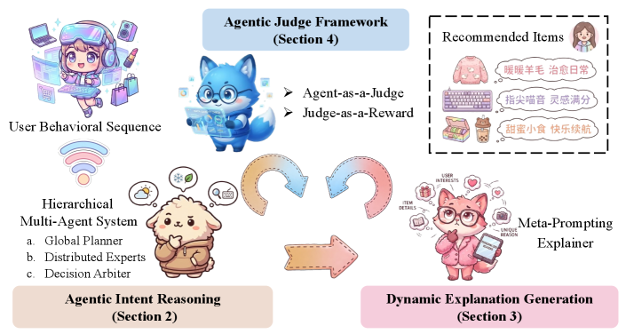

# RecGPT-V2: Hierarchical Multi-Agent User Intent Reasoning

<!-- source-sha256: b63a832305f3a285fe0f4db1db3040546852da3efa16bc07592c20eee5295570 -->

[简体中文](README.md)

> **Core mechanism evidence.** Paper and local evaluations are separate.

## Paper information

| Field | Value |
| --- | --- |
| Paper | [arXiv 2512.14503](https://arxiv.org/abs/2512.14503) |
| Affiliations | Alibaba / Taobao |
| First public release | 2025-12-16 (arXiv v1) |
| Authors' code | No official author code linked as of 2026-08-09. |
| Adapter / method | `recgpt-v2` |
| Local code | [`src/auto_research/reproductions/recgpt_v2/`](https://github.com/daiwk/auto-research/tree/main/src/auto_research/reproductions/recgpt_v2/) |

## Original paper

### Background and contribution

Fixed V1 chains duplicate work and generalize poorly. V2 uses hierarchical intent agents, compressed mixed behavior representations, dynamic meta-prompts, multi-reward constrained RL, and Agent-as-a-Judge.


<!-- paper-figure:start -->
### Key figure from the paper

[](https://ar5iv.labs.arxiv.org/html/2512.14503/assets/x2.png)

Original Figure 2: RecGPT-V2. From the [paper](https://arxiv.org/abs/2512.14503); copyright belongs to the authors. Not a local result.
<!-- paper-figure:end -->

### Core mechanism

$$
\pi(a\mid h)=\sum_k g_k(h)\pi_k(a\mid h),\qquad
\max_\pi\ \mathbb E[R]-\beta D_{\mathrm{KL}}(\pi\Vert\pi_0).
$$

### Paper results

Paper exclusive recall 9.39%→10.99%, GPU use −60%, tag prediction +24.1%, explanation acceptance +13.0%. Taobao live CTR +2.98%, IPV +3.71%, TV +2.19%, NER +11.46%.

## Local reproduction

Vs. single-route V1 proxy: Hit@10 0.14048→0.14762, NDCG@10 0.07514→0.08905 (+18.52%), head share 0.21762→0.18167. [Metrics](metrics/movielens-1m-seed42.json).

```bash
auto-research reproduce --paper recgpt-v2 --dataset-dir data --seed 42
```

## Reproduction limits

Agents are small trainable public-data experts, not private LLMs. No human judge labels, explanations, or online resource measurements.
