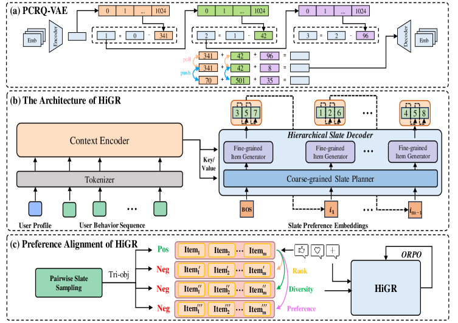

# HiGR: Hierarchical Generative Slate Recommendation

<!-- source-sha256: 22c973f018faaa7dd2460e5cbb664b7a00fc26a9c37520ff82c2d5708bdae67d -->

[简体中文](README.md)

> Learns two residual SID levels and runs coarse-to-fine decoding with ORPO-style reranking.

## Paper information

| Field | Details |
|---|---|
| Paper | [arXiv 2512.24787](https://arxiv.org/abs/2512.24787) |
| Institution | Tencent. |
| First public release | 2025-12-31 (arXiv v1) |
| Author code | No official author code linked by the paper as checked on 2026-08-09. |
| Local adapter or method key | `higr` |
| Local reproduction code | [`src/auto_research/reproductions/higr/`](https://github.com/daiwk/auto-research/tree/main/src/auto_research/reproductions/higr/) |

## Paper method and evidence

Itemwise generation overlooks slate interactions. PCRQ-VAE produces hierarchical semantic IDs. The hierarchical decoder picks clusters before items, and ORPO aligns whole-page preferences.


<!-- paper-figure:start -->
### Original paper figure

[](https://arxiv.org/html/2512.24787v5/x1.png)

The original figure shows hierarchical slate generation. From the [original paper](https://arxiv.org/abs/2512.24787); copyright remains with the authors.
<!-- paper-figure:end -->

### Core equation

$$
i\mapsto(c_i^{(1)},c_i^{(2)}),\qquad
\mathcal L_{\mathrm{ORPO}}=-\log p(y^+|x)
-\lambda\log\sigma(\logit p(y^+|x)-\logit p(y^-|x)).
$$

### Reported results

On public KuaiRec and Tencent data, hierarchy and ORPO outperform flat generation. At 5% online traffic, stay time +1.03%, watch time +1.22%, video views +1.73%, request count +1.57%.

## Local reproduction

Versus a flat item slate on MovieLens-1M, NDCG@10 **0.07514→0.06588 (-12.32%)**, head share **0.21762→0.15714**. Diversity improves while accuracy falls; online gains were not reproduced. [Metrics](metrics/movielens-1m-seed42.json).

```bash
auto-research reproduce --paper higr --dataset-dir data --seed 42
```

Single next-item feedback is not video-slate feedback; k-means residual IDs are not production PCRQ-VAE.
