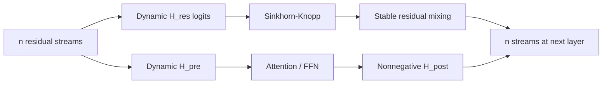
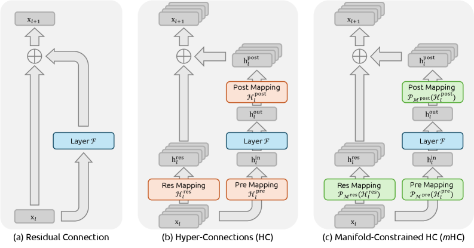

<!-- source-sha256: 21a19f00764c680dc7855baac5ab5111894a64b8981e5269d830c3b0fdb7b6c5 -->

[简体中文](README.md) · English

# mHC: Manifold-constrained hyper-connections

> **Fidelity: core-mechanism reproduction.** Trains dynamic two-stream HC/mHC in a small causal Transformer, applies 20 Sinkhorn-Knopp iterations to residual maps, and measures row/column constraints and spectral norm.

## Paper information

| Field | Details |
| --- | --- |
| Paper | [arXiv 2512.24880](https://arxiv.org/abs/2512.24880) |
| Institution | DeepSeek-AI |
| First public release | 2025-12-31 (arXiv v1) |
| Author code | No official or author-released code found in the paper (checked 2026-08-09). |
| Local adapter or method key | `mhc` |
| Local reproduction code | [`src/auto_research/reproductions/mhc/`](https://github.com/daiwk/auto-research/tree/main/src/auto_research/reproductions/mhc/) |

## Original paper summary

### Background and main changes

Hyper-Connections expand one residual stream to multiple streams and mix them dynamically. An arbitrary residual matrix can break the identity map and amplify signals in deep compositions. mHC projects $H^{res}$ onto the Birkhoff polytope (nonnegative, with every row and column summing to 1) and constrains $H^{pre}$ and $H^{post}$ to be nonnegative. This retains cross-stream exchange while keeping each layer's residual map nonexpansive. The paper also supplies fused kernels, activation recomputation, and DualPipe overlap to control overhead.



<!-- paper-figure:start -->
### Key figure from the paper

[](https://ar5iv.labs.arxiv.org/html/2512.24880/assets/x1.png)

> **Figure 1:** Overall design and components. From the [paper](https://arxiv.org/abs/2512.24880); copyright belongs to the authors. Click for the source.
<!-- paper-figure:end -->

### Core equations

$$
x_{l+1}=H_l^{res}x_l+H_l^{post}\,F(H_l^{pre}x_l;W_l),
$$

$$
H_l^{res}=\operatorname{Sinkhorn}(\widetilde H_l^{res}),\quad
H_l^{res}\mathbf 1=\mathbf 1,\quad \mathbf 1^\top H_l^{res}=\mathbf 1^\top,\quad H_l^{res}\ge0.
$$

### Offline and online results

On 3B, 9B, and 27B DeepSeek-V3 architectures, the paper reports key benchmark gains of roughly `2.1%–2.3%` over the baseline. Optimized training overhead is `6.7%`. This is a foundation-model architecture paper, with no production online A/B test.

## Local reproduction

> **Local comparison:** The baseline is a standard Transformer with the same tokens, optimizer, and backbone width. With mHC, validation PPL goes from `468.903 to 472.031`, a **`-0.67%`** relative improvement (no observed quality gain). Residual spectral norm goes from `1.0892 to 1.0000`, and maximum row/column sum error from `~0.11 to 0`.

WikiText-2 uses 180k training tokens, 24k validation tokens, BPE-1024, 3 layers, hidden size 64, and 45 steps. HC reaches PPL `471.796` and mHC `472.031`. Language-modeling differences across the three arms are small under short training, but the mHC geometry constraints hold exactly. See [`metrics/wikitext2-seed42.json`](metrics/wikitext2-seed42.json).

```bash
pip install -e '.[llm-evolution]'
auto-research reproduce --paper mhc --seed 42 --device auto
```

## Scope

The local run does not reproduce 3B/9B/27B MoE, extremely deep training, fused TileLang kernels, segmented recomputation, or DualPipe. The small model verifies the mHC mathematics and short-run training, not the gains at paper scale.
