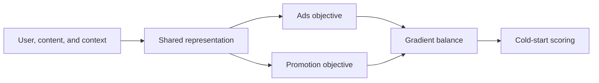
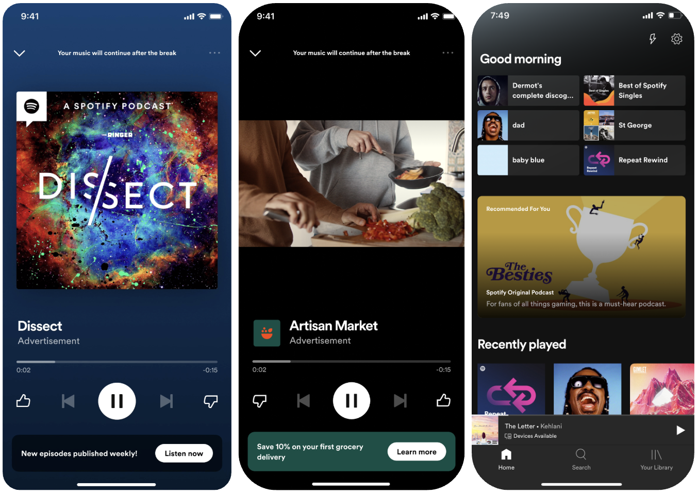

# Spotify Podcast: multitask learning for cold-start ads and promotion

<!-- source-sha256: ea838c6cfbe0c3c842f86e510642d7da5ea7fa0e667b3e85807184aaa9ebe1ad -->

[简体中文](README.md)

> **Fidelity: core mechanism.** Runs a shared low-rank multitask representation and cold-item bucketing.

## Paper information

| Field | Details |
|---|---|
| Paper | [arXiv 2601.02306](https://arxiv.org/abs/2601.02306) |
| Organization | Spotify |
| First public release | 2026-01-05 (arXiv v1) |
| Authors' code | The paper did not supply official or author code when checked on 2026-08-09. |
| Adapter / method | `podcast-mtl` |
| Local reproduction code | [`src/auto_research/reproductions/podcast_mtl/`](https://github.com/daiwk/auto-research/tree/main/src/auto_research/reproductions/podcast_mtl/) |

## Original paper

### Motivation and method

New podcasts lack ad click and stream data. The paper jointly trains ads and organic promotion, sharing user, content, and context representations to transfer signal from rich tasks to cold-start tasks. Imbalance handling and gradient balancing limit negative transfer.



<!-- paper-figure:start -->
### Key figure from the paper

[](https://arxiv.org/html/2601.02306v1/Figures/pso-ex-3.png)

> **Figure 1:** Overview of the paper's method and key components. From the [original paper](https://arxiv.org/abs/2601.02306); copyright remains with the authors.
<!-- paper-figure:end -->

### Core equations

$$
\mathcal L=\alpha\mathcal L_{\mathrm{ads}}+
(1-\alpha)\mathcal L_{\mathrm{promotion}},\qquad
h=W_sx,\quad \hat y_t=W_th.
$$

### Paper results

Effective cost per stream decreases by up to `22%`; podcast stream rate rises `18%` to `24%`, with stronger gains on cold content.

## Local reproduction

> **Local comparison:** The baseline is a single-task popularity/content ranker. The joint organic/promotion treatment changes NDCG@10 from `0.03540→0.02810`, or **-20.63%** relative. Local negative transfer occurs.

This negative result is retained. The proxy tasks and weights need further evolve work. See the [metrics](metrics/movielens-seed42.json).

```bash
auto-research reproduce --paper podcast-mtl --dataset-dir data --seed 42
```

## Reproduction boundaries

MovieLens movies and genres stand in for podcasts and ad features. Spotify impressions, bids, and exposure-calibration logs are unavailable.
