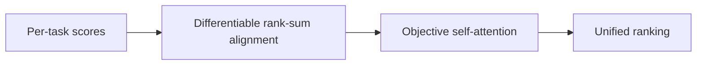
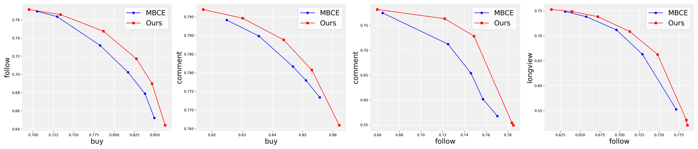

# HarmonRank: Rank-consistent multi-objective ensembling

<!-- source-sha256: b8f281c2e714ba4f374aaec918468aaf39c0ce28524e9d71f5f864ee0815da76 -->

[简体中文](README.md)

> Core public-data mechanism, not industrial ranking.

## Paper information

| Field | Details |
|---|---|
| Paper | [Paper or original source](https://arxiv.org/abs/2601.02955) |
| Institution | Kuaishou Technology. |
| First public release | 2026-01-06 (arXiv v1) |
| Author code | No public author code found as of 2026-09-05. |
| Local adapter or method key | `harmonrank` |
| Local reproduction code | [`src/auto_research/reproductions/harmonrank/`](https://github.com/daiwk/auto-research/tree/main/src/auto_research/reproductions/harmonrank/) |

## Paper method and evidence

Rewrite AUC as a differentiable rank-sum objective to align tasks in ranking space. Then learn dependencies among objectives such as purchases and comments with self-attention to produce one ranking.



<!-- paper-figure:start -->
### Original paper figure

[](https://ar5iv.labs.arxiv.org/html/2601.02955/assets/analysis2.png)

Figure shows rank-alignment and objective attention. From the [original paper](https://arxiv.org/abs/2601.02955); copyright remains with the authors.
<!-- paper-figure:end -->

### Core equation

$$
\mathcal L_{rank}=-\sum_k\mathrm{AUC}_{soft}(s_k,y_k),\qquad S=\mathrm{Attn}(R_1,\ldots,R_K).
$$

### Reported results

Kuaishou live commerce reports purchases +2.635% and watch time +0.451%.

## Local reproduction

```bash
auto-research reproduce --paper harmonrank --dataset-dir data --seeds 42,43,44
```

MovieLens-100K fixed full catalog: NDCG@10 **0.05401→0.05203 (-3.65%)**. [Three-seed metrics, mean, SD and 95% CI](metrics/public-seeds42-44.json). Auditable proxy, not the production objective. No private features, production traffic or serving. These local public-data results do not reproduce online lift.
