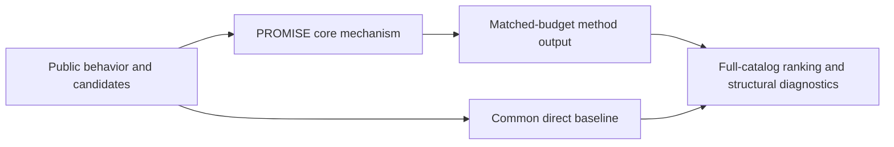
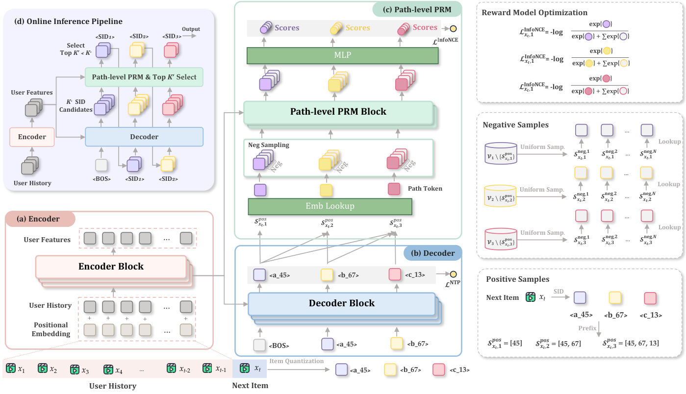

# PROMISE: process reward models for generative recommendation

<!-- source-sha256: 96a112021838f799f8b9b900dc44f563bbdebf8c8c5f658e032ed7ea51178573 -->

[简体中文](README.md)

> **Fidelity: core mechanism.** Runs the defining mechanism verifiable on public data. Private data, production models, and serving remain outside scope.

## Paper information

| Field | Details |
|---|---|
| Paper | [arXiv 2601.04674](https://arxiv.org/abs/2601.04674) |
| Organization | Kuaishou Technology |
| First public release | 2026-01-08 (arXiv v1) |
| Authors' code | No public author code was found on 2026-09-05. |
| Adapter / method | `promise` |
| Local reproduction code | [`src/auto_research/reproductions/promise/`](https://github.com/daiwk/auto-research/tree/main/src/auto_research/reproductions/promise/) |

## Original paper

### Motivation and method

A lightweight path-level PRM evaluates intermediate paths at every SID level. It provides dense training feedback and prunes semantically drifting beams early at inference. Wider beams then give controllable test-time scaling.



<!-- paper-figure:start -->
### Key figure from the paper

[](https://arxiv.org/html/2601.04674v1/main3.png)

> **Figure 2:** Core architecture, modules, and connections. From the [original paper](https://arxiv.org/abs/2601.04674); copyright remains with the authors.
<!-- paper-figure:end -->

### Core equations

$$
R(z_{1:L})=\sum_{l=1}^L r_\phi(z_{\le l},u),\qquad \mathcal B_l=\operatorname{TopK}_{z_{\le l}}\bigl(\log p_\theta+\lambda R\bigr).
$$

### Paper results

The paper reports a +5% production online core metric gain. This is paper evidence, not a local public-data outcome.

## Local reproduction

> **Local comparison:** Under the same full-catalog protocol, baseline NDCG@10 is 0.05401 and PROMISE NDCG@10 is 0.05929, **+9.79%** relative. The local proxy does not extrapolate to online lift.

See the [three-seed artifact](metrics/public-seeds42-44.json) for complete results, means, standard deviations, and 95% confidence intervals.

```bash
auto-research reproduce --paper promise --dataset-dir data --seeds 42,43,44
```

## Reproduction boundaries

The local run uses a fixed public MovieLens 100K subset and auditable proxies to validate the core computation. It does not reproduce private logs, production models, online traffic assignment, or serving. No claim is made to reproduce absolute paper metrics or online gains.
