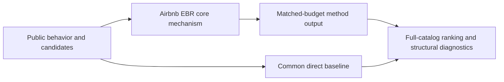
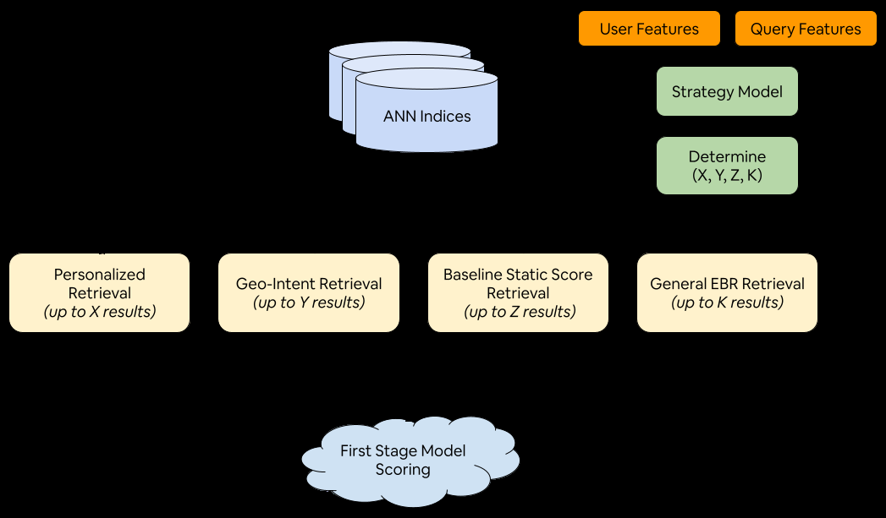

# Airbnb EBR: embedding retrieval for a two-sided marketplace

<!-- source-sha256: 6866a1a66ecb6a16e5a7abb04027dcdea7177e25498bc0e4020b3baaa4c639eb -->

[简体中文](README.md)

> **Fidelity: core mechanism.** Runs the defining mechanism verifiable on public data. Private data, production models, and serving remain outside scope.

## Paper information

| Field | Details |
|---|---|
| Paper | [arXiv 2601.06873](https://arxiv.org/abs/2601.06873) |
| Organization | Airbnb |
| First public release | 2026-01-11 (arXiv v1) |
| Authors' code | No public author code was found on 2026-09-05. |
| Adapter / method | `airbnb-ebr` |
| Local reproduction code | [`src/auto_research/reproductions/airbnb_ebr/`](https://github.com/daiwk/auto-research/tree/main/src/auto_research/reproductions/airbnb_ebr/) |

## Original paper

### Motivation and method

Construct positives and hard negatives from the search–browse–book journey, and align first-stage retrieval with traffic replay. Online serving combines HNSW/IVF, geographic filters, and frequent inventory updates.



<!-- paper-figure:start -->
### Key figure from the paper

[](https://arxiv.org/html/2601.06873v1/figures/Listing_Retrieval_System__Generalized_Architecture.png)

> **Figure 9:** Core architecture, modules, and connections. From the [original paper](https://arxiv.org/abs/2601.06873); copyright remains with the authors.
<!-- paper-figure:end -->

### Core equations

$$
s(q,i)=\langle e_q,e_i\rangle,\qquad \mathcal L=-\log\frac{e^{s(q,i^+)}}{e^{s(q,i^+)}+\sum_j e^{s(q,i_j^-)}}.
$$

### Paper results

Booking conversion rises +0.31%; embedding retrieval handles about 16% of relevant online traffic. This is paper evidence, not a local public-data outcome.

## Local reproduction

> **Local comparison:** Under the same full-catalog protocol, baseline NDCG@10 is 0.05401 and Airbnb EBR NDCG@10 is 0.04943, **-8.48%** relative. The local proxy does not extrapolate to online lift.

See the [three-seed artifact](metrics/public-seeds42-44.json) for complete results, means, standard deviations, and 95% confidence intervals.

```bash
auto-research reproduce --paper airbnb-ebr --dataset-dir data --seeds 42,43,44
```

## Reproduction boundaries

The local run uses a fixed public MovieLens 100K subset and auditable proxies to validate the core computation. It does not reproduce private logs, production models, online traffic assignment, or serving. No claim is made to reproduce absolute paper metrics or online gains.
