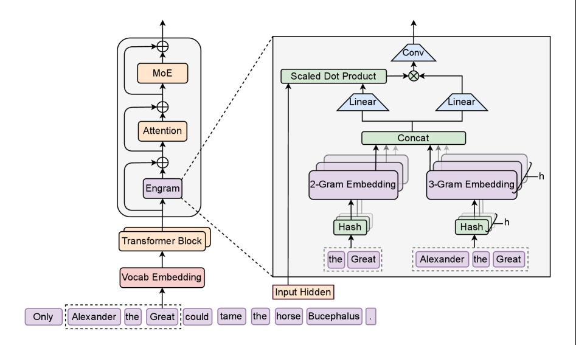

# Engram: Conditional memory through scalable table lookup

<!-- source-sha256: c01626b4540a8845a9d7382670ec2bd988cdc6fb51d742a5177e8fd571bb79ed -->

[简体中文](README.md)

> Trainable hashed n-gram memory with gated fusion, connected to LLM Evolve.

## Paper information

| Field | Details |
|---|---|
| Paper | [arXiv 2601.07372](https://arxiv.org/abs/2601.07372) |
| Institution | DeepSeek. |
| First public release | 2026-01-12 (arXiv v1) |
| Author code | [deepseek-ai/Engram](https://github.com/deepseek-ai/Engram). |
| Local adapter or method key | `engram` |
| Local reproduction code | [`src/auto_research/reproductions/engram/`](https://github.com/daiwk/auto-research/tree/main/src/auto_research/reproductions/engram/) |

## Paper method and evidence

MoE adds conditional compute, but layers still reconstruct static local patterns. Hash normalized n-grams into a large embedding table for deterministic $O(1)$ lookup, then gate memory into early layers so attention/FFNs can focus on compositional reasoning.


<!-- paper-figure:start -->
### Original paper figure

[](https://arxiv.org/html/2601.07372v2/x1.png)

The original figure shows hash lookup and gated fusion. From the [original paper](https://arxiv.org/abs/2601.07372); copyright remains with the authors.
<!-- paper-figure:end -->

### Core equation

$$
a_t=\operatorname{Hash}(x_{t-n+1:t})\bmod B,\quad
m_t=E[a_t],\quad
h_t'=h_t+\sigma(W[h_t;m_t])\odot m_t.
$$

### Reported results

Against compute-only sparse models, the paper reports MMLU +3.4, BBH +5.0, and HumanEval +3.0, with under 3% overhead after prefetching. No industrial A/B criterion applies.

## Local reproduction

```bash
auto-research reproduce --paper engram --dataset-dir data --seed 42
auto-research evolve --model micro-llm --dataset wikitext-2 --direction "Compare Engram conditional memory"
```

Against budget-matched `llama_modern`, add 4096-bucket trigram memory. WikiText-2 loss **5.7471→6.1533 (+7.07%, worse)**; PPL **313.27→470.27**. Thirty steps are too short for 270,000 added memory parameters, suggesting budget and capacity should be explored together. [Metrics](metrics/wikitext2-seed42.json). No 27B/MoE pretraining, distributed table, or asynchronous prefetch.
