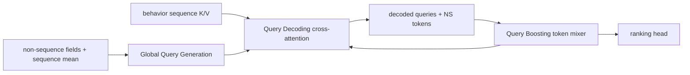
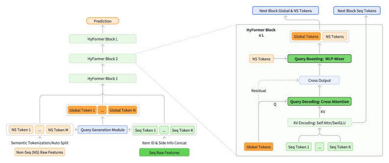

# HyFormer: Bidirectional Sequence–Feature Co-Evolution

<!-- source-sha256: 67aae22b6fae0760740c9ab92eabad98670b0b16fa6a249e12a2c4ee77e38eb9 -->

[简体中文](README.md)

> **Fidelity: full core pipeline.** Query Generation, Query Decoding, and Query Boosting run at each layer. One MovieLens sequence replaces private multibehavior histories.

## Paper information

| Field | Details |
|---|---|
| Paper | [arXiv 2601.12681](https://arxiv.org/abs/2601.12681) |
| Organization | ByteDance / Douyin Search |
| First public release | 2026-01-19 (arXiv v1) |
| Authors' code | No official or author implementation is linked by the paper (checked 2026-08-09). |
| Adapter / method | `hyformer` |
| Local reproduction code | [`src/auto_research/reproductions/hyformer/`](https://github.com/daiwk/auto-research/tree/main/src/auto_research/reproductions/hyformer/) |

## Original paper

### Motivation and method

Serial architectures such as LONGER→RankMixer first compress history and then mix heterogeneous fields, delaying interaction and keeping it one-way. HyFormer generates Global Queries from non-sequence fields and mean sequence features. Each layer cross-attends the current sequence K/V, then mixes decoded queries with non-sequence tokens using RankMixer-style boosting. Boosted queries decode again in the next layer, making co-evolution bidirectional and iterative.



<!-- paper-figure:start -->
### Key figure from the paper

[](https://ar5iv.labs.arxiv.org/html/2601.12681/assets/x1.png)

> **Figure 1:** Core architecture, its modules, and their connections. From the [original paper](https://arxiv.org/abs/2601.12681); copyright remains with the authors.
<!-- paper-figure:end -->

### Core equations

$$
Q^{(0)}=[\mathrm{FFN}_1(Global),\ldots,\mathrm{FFN}_N(Global)],
$$

$$
\widehat Q^{(l)}=\operatorname{CrossAttn}(Q^{(l-1)},K^{(l)},V^{(l)}),
$$

$$
Q^{(l)}=Q+\operatorname{PerTokenFFN}(\operatorname{TokenMix}(Q)).
$$

### Paper results

Industrial AUC rises approximately +0.74% relative. Online Douyin Search reports watch time/U +0.293%, finish play/U +1.111%, and query change rate -0.236%.

## Local reproduction

> **Local comparison.** Late Fusion with a separate sequence Transformer and dense MLP versus HyFormer. NDCG@10 goes 0.0048 to 0.0116 (**+143.77%**), with head share up 30.90 percentage points. This ablates co-evolution, not DIN.

The run uses two queries, two non-sequence tokens, width 64, two layers, history length 32, and 240 steps per arm across three seeds.

| Architecture | Hit@10 | NDCG@10 | Head share@10 |
| --- | ---: | ---: | ---: |
| Late fusion | 0.0097 ± 0.0023 | 0.0048 ± 0.0008 | 0.1398 |
| HyFormer | **0.0240 ± 0.0031** | **0.0116 ± 0.0018** | 0.4488 |

The architecture wins this small comparison, but the head-share increase shows strong use of popularity. The gain cannot all be attributed to better personalized long-history modeling. See [structured metrics](metrics/movielens-100k-seed42.json).

```bash
auto-research reproduce --paper hyformer --dataset-dir data --seed 42
```

Models and raw outputs stay in Git-ignored `runs/`.
