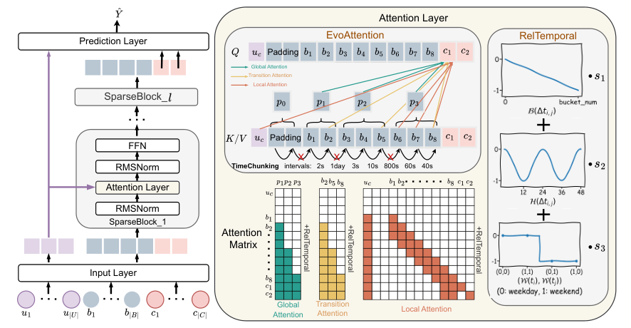

# SparseCTR: Evolving sparse attention for long behavior histories

<!-- source-sha256: c2582e3db342d8b94ea8b9cd9c39b53c32af886c041d542722282de6a4bbb961 -->

[简体中文](README.md)

> Core public-data sequence mechanism.

## Paper information

| Field | Details |
|---|---|
| Paper | [Paper or original source](https://arxiv.org/abs/2601.17836) |
| Institution | Institute of Software, Chinese Academy of Sciences. |
| First public release | 2026-01-25 (arXiv v1) |
| Author code | [laiweijiang/SparseCTR](https://github.com/laiweijiang/SparseCTR). |
| Local adapter or method key | `sparsectr` |
| Local reproduction code | [`src/auto_research/reproductions/sparsectr/`](https://github.com/daiwk/auto-research/tree/main/src/auto_research/reproductions/sparsectr/) |

## Paper method and evidence

TimeChunking adapts to a user's inter-event intervals. EvoAttention combines global chunk, interest-transition and local-window attention; RelTemporal adds relative interval, hour and weekend biases.


<!-- paper-figure:start -->
### Original paper figure

[](https://arxiv.org/html/2601.17836v1/model.png)

The original figure shows temporal chunking and attention. From the [original paper](https://arxiv.org/abs/2601.17836); copyright remains with the authors.
<!-- paper-figure:end -->

### Core equation

$$
H=\alpha_gA_{global}+\alpha_tA_{transition}+\alpha_lA_{local},\qquad A=\mathrm{softmax}(QK^\top/\sqrt d+B_{time})V.
$$

### Reported results

Seven-day 1%-traffic experiment: CTR +1.72%, CPM +1.41%, history length 128→1024.

## Local reproduction

MovieLens-100K full catalog: NDCG@10 **0.05401→0.05519 (+2.19%)**. [Three-seed metrics, mean, SD and 95% CI](metrics/public-seeds42-44.json). No private logs, production models, live traffic, or serving; public-data measures do not establish online lift.

```bash
auto-research reproduce --paper sparsectr --dataset-dir data --seeds 42,43,44
```
