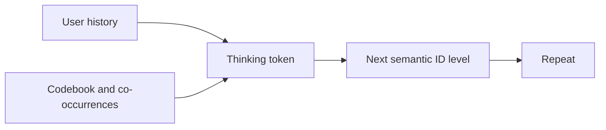
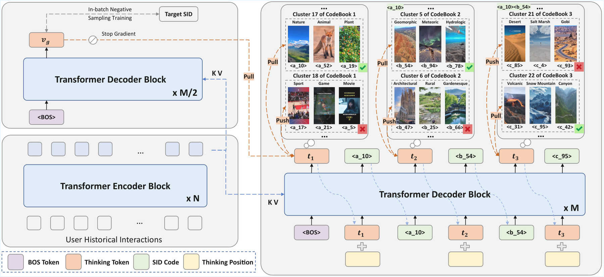

# S2GR: Stepwise Semantic Guidance in Latent Space

<!-- source-sha256: 2f5fa0a3424802ac8bdec8131ad645ccc62336c5a06a9deb901b5abd7576c140 -->

[简体中文](README.md)

> **Core mechanism evidence.** Paper and local evaluations are separate.

## Paper information

| Field | Value |
| --- | --- |
| Paper | [arXiv 2601.18664](https://arxiv.org/abs/2601.18664) |
| Affiliations | Kuaishou Technology |
| First public release | 2026-01-26 (arXiv v1) |
| Authors' code | No public author implementation found as of 2026-09-05. |
| Adapter / method | `s2gr` |
| Local code | [`src/auto_research/reproductions/s2gr/`](https://github.com/daiwk/auto-research/tree/main/src/auto_research/reproductions/s2gr/) |

## Original paper

### Background and contribution

Insert interpretable thinking tokens before each SID level and align with codebook distributions contrastively. Co-occurrence and load balancing improve the coarse-to-fine hierarchy.



<!-- paper-figure:start -->
### Key figure from the paper

[](https://arxiv.org/html/2601.18664v3/framework.png)

Original Figure 3: S2GR. From the [paper](https://arxiv.org/abs/2601.18664); copyright belongs to the authors. Not a local result.
<!-- paper-figure:end -->

### Core mechanism

$$
p(z_l\mid z_{<l},t_{\le l},u),\qquad \mathcal L=\mathcal L_{gen}+\lambda\mathcal L_{think}+\gamma\mathcal L_{balance}.
$$

### Paper results

Paper core online recommendation metric +5.25%, not local gain.

## Local reproduction

Matched full-catalog MovieLens NDCG@10 0.05401→0.05463 (+1.15%). [Three-seed metrics, SD, and 95% CI](metrics/public-seeds42-44.json).

```bash
auto-research reproduce --paper s2gr --dataset-dir data --seeds 42,43,44
```

## Reproduction limits

Fixed public MovieLens 100K subset and auditable proxy only. No private logs, production base models, bucketing, or serving.
