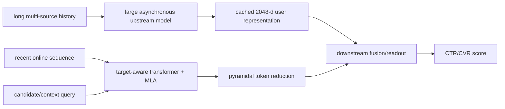
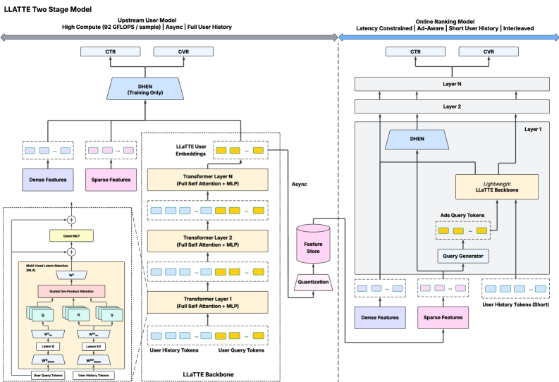

# LLaTTE: Multi-stage sequence scaling

<!-- source-sha256: 11783491e94d289e084dc7bd3a508aa9af2d152afac4ee0ccc6a4fbd94242b41 -->

[简体中文](README.md)

> **Fidelity: Core mechanism.** The implementation runs BERT-tiny semantic features, upstream MLA latents, target-aware online attention, and DHEN gating. Meta's private ad features and asynchronous production serving are not reproduced.

## Paper information

| Field | Value |
| --- | --- |
| Paper link | [arXiv 2601.20083](https://arxiv.org/abs/2601.20083) |
| Organization | Meta |
| First published | 2026-01-27 (arXiv v1) |
| Original author code | No official or author code was provided in the paper (checked 2026-08-09). |
| Adapter | `llatte` |
| Local reproduction code | [`src/auto_research/reproductions/llatte/`](https://github.com/daiwk/auto-research/tree/main/src/auto_research/reproductions/llatte/) |

## Original paper summary

### Background and main changes

Industrial recommendation sequence models face training FLOPs, serving latency, and information loss between stages. Extending history directly makes online ranking costly, and a larger downstream model cannot recover long-term interests discarded upstream. LLaTTE scales in two stages. A large asynchronous upstream model consumes very long histories from multiple sources and caches a 2,048-dimensional user representation. The online model reads around 400 events and uses target-aware queries, multi-head latent attention (MLA), and pyramidal token reduction to aggregate candidate-relevant information.

<!-- paper-figure:start -->
### Key figure from the paper

**Original Figure 1 (architecture):** Main modules and their connections. Image from the [original paper](https://arxiv.org/abs/2601.20083); copyright belongs to the authors. Click the image for its source.
<!-- paper-figure:end -->

### Core equations

Candidate context $c$ enters the query for target-aware attention:

$$
q_t=W_Q[x_t;c],\quad k_i=W_Kx_i,\quad
h_t=\sum_i\operatorname{softmax}_i(q_t^Tk_i/\sqrt d)W_Vx_i.
$$

The empirical scaling observation is:

$$
\Delta NE(C)\propto-\alpha\log_{10}C,
$$

Cross-stage transfer efficiency is:

$$
\tau=\frac{\Delta NE_{downstream}}{\Delta NE_{upstream}}.
$$

It measures how much upstream sequence compute improvement carries over to the online downstream model.

### Offline and online results in the paper

Internal experiments use roughly 30 billion training examples, 128 H100s, and 229K steps. Balanced depth and width outperform extremely deep narrow or shallow wide models. The upstream sequence-compute variant improves NE by about -0.14%, with about -0.07% downstream and $\tau\approx50\%$. The model-scaling variant gives about -0.13% upstream and -0.07% downstream, $\tau\approx53\%$. These internal results cannot be checked point by point on public data.

Multiple large A/B tests report **+4.3%** Facebook Feed/Reels conversion and **-0.25%** NE for the flagship ads ranker, with no measurable change in P99 ranking latency.

## Local reproduction

> **Control:** A short online sequence with the same ID and semantic embeddings. The comparison adds upstream MLA, target-aware online attention, and DHEN, improving NDCG@10 by **+49.81%** under the same training budget. It is not a DIN comparison.

Public `prajjwal1/bert-tiny` encodes and caches MovieLens titles. The sequence model sees both ID and semantic tokens. 4 latent queries compress the full history; a candidate query reads the most recent 12 events; DHEN learns gates over three experts. Ratings ≥4, per-user leave-two-out, full catalog, three seeds.

| Architecture | Hit@10 | NDCG@10 |
|---|---:|---:|
| Short online sequence | 0.0079 ± 0.0013 | 0.0039 ± 0.0005 |
| LLaTTE MLA + DHEN | **0.0118 ± 0.0009** | **0.0058 ± 0.0003** |

NDCG@10 improves **+49.81%**, while head share rises from 8.55% to 15.85%, so part of the gain accompanies greater popularity concentration. This local public-data run outperforms a matched short baseline; it is not Meta's online conversion result. See [metrics/movielens-100k-seeds42-44.json](metrics/movielens-100k-seeds42-44.json).
