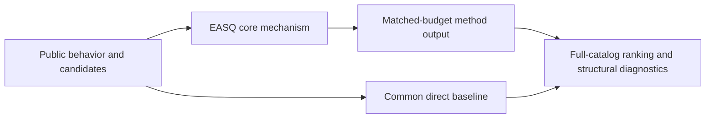
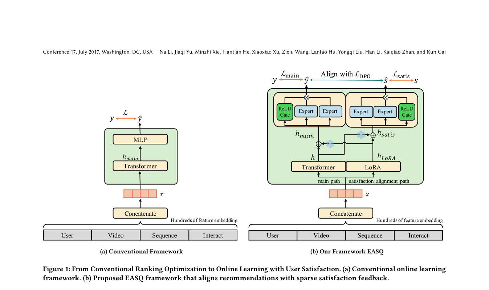

# EASQ: end-to-end alignment to survey satisfaction

<!-- source-sha256: 8f33cdaa4d73e2eb22f05bbf89581af73c19eb30261ff27cf0d8587726d69fa2 -->

[简体中文](README.md)

> **Fidelity: core mechanism.** Runs the defining mechanism verifiable on public data. Private data, production models, and serving remain outside scope.

## Paper information

| Field | Details |
|---|---|
| Paper | [arXiv 2601.20215](https://arxiv.org/abs/2601.20215) |
| Organization | Kuaishou Technology |
| First public release | 2026-01-28 (arXiv v1) |
| Authors' code | No public author code was found on 2026-09-05. |
| Adapter / method | `easq` |
| Local reproduction code | [`src/auto_research/reproductions/easq/`](https://github.com/daiwk/auto-research/tree/main/src/auto_research/reproductions/easq/) |

## Original paper

### Motivation and method

Keep sparse survey satisfaction supervision in its own LoRA path so abundant behavioral labels do not drown it out. Online DPO uses a survey expert as a dynamic reference and updates satisfaction preferences while minimizing disruption to the main ranking backbone.



<!-- paper-figure:start -->
### Key figure from the paper

[](https://arxiv.org/pdf/2601.20215#page=4)

> **Figure 1:** Core architecture, modules, and connections. From the [original paper](https://arxiv.org/abs/2601.20215); copyright remains with the authors.
<!-- paper-figure:end -->

### Core equations

$$
\mathcal L=\mathcal L_{rank}-\beta\log\sigma\!\left(\Delta\log\pi_\theta-\Delta\log\pi_{ref}\right).
$$

### Paper results

Production A/B reports a +5.1% increase in a user satisfaction-related metric. This is paper evidence, not a local public-data outcome.

## Local reproduction

> **Local comparison:** Under the same full-catalog protocol, baseline NDCG@10 is 0.05401 and EASQ NDCG@10 is 0.05160, **-4.46%** relative. The local proxy does not extrapolate to online lift.

See the [three-seed artifact](metrics/public-seeds42-44.json) for complete results, means, standard deviations, and 95% confidence intervals.

```bash
auto-research reproduce --paper easq --dataset-dir data --seeds 42,43,44
```

## Reproduction boundaries

The local run uses a fixed public MovieLens 100K subset and auditable proxies to validate the core computation. It does not reproduce private logs, production models, online traffic assignment, or serving. No claim is made to reproduce absolute paper metrics or online gains.
