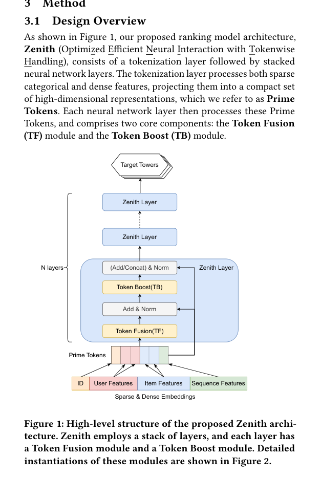

# Zenith: Scale ranking with Prime Tokens

<!-- source-sha256: e607e79b7d2e793b0aa19dec231a77b628036fe9cc4cdcacacd67451fac84b91 -->

[简体中文](README.md)

> Core public-data mechanism, not production serving.

## Paper information

| Field | Details |
|---|---|
| Paper | [arXiv 2601.21285](https://arxiv.org/abs/2601.21285) |
| Institution | North Carolina State University. |
| First public release | 2026-01-29 (arXiv v1) |
| Author code | No public author code found as of 2026-09-05. |
| Local adapter or method key | `zenith` |
| Local reproduction code | [`src/auto_research/reproductions/zenith/`](https://github.com/daiwk/auto-research/tree/main/src/auto_research/reproductions/zenith/) |

## Paper method and evidence

Token Fusion compresses heterogeneous sparse features into fewer high-dimensional Prime Tokens. RSA/TMHSA maintain token diversity, while TSwiGLU/TSMoE independently enhance tokens for better compute/size scaling.


<!-- paper-figure:start -->
### Original paper figure

[](https://arxiv.org/pdf/2601.21285#page=3)

The original figure shows token fusion and boosting. From the [original paper](https://arxiv.org/abs/2601.21285); copyright remains with the authors.
<!-- paper-figure:end -->

### Core equation

$$
P=\mathrm{TokenFusion}(E),\qquad P'=P+\mathrm{TokenBoost}(P).
$$

### Reported results

TikTok Live A/B: Quality Watch Session/User +9.93%, Quality Watch Duration/User +8.11%, CTR AUC +1.05%. Paper evidence only.

## Local reproduction

```bash
auto-research reproduce --paper zenith --dataset-dir data --seeds 42,43,44
```

Same MovieLens-100K full-catalog protocol: NDCG@10 **0.05401→0.04623 (-14.40%)**. [Three-seed measurements, mean, SD and 95% CI](metrics/public-seeds42-44.json). The public proxy does not reproduce private logs, foundation models, bucketing, serving or online lift.
