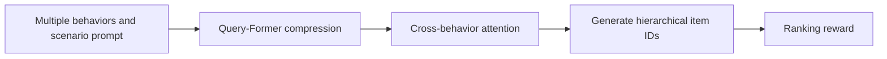
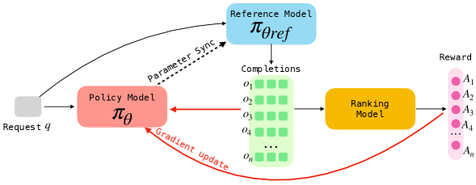

# OneMall: Unified end-to-end generative recommendation across scenarios

<!-- source-sha256: 87ee089aa688db506c5911531dab2da1b6d190c8339739a8aa63357caeea67d2 -->

[简体中文](README.md)

> Core scenario prompts, three-level SIDs and cross-behavior fusion on a reduced public dataset.

## Paper information

| Field | Details |
|---|---|
| Paper | [arXiv 2601.21770](https://arxiv.org/abs/2601.21770) |
| Institution | Kuaishou. |
| First public release | 2026-01-29 (arXiv v1) |
| Author code | No official author code linked by the paper as checked on 2026-08-09. |
| Local adapter or method key | `onemall` |
| Local reproduction code | [`src/auto_research/reproductions/onemall/`](https://github.com/daiwk/auto-research/tree/main/src/auto_research/reproductions/onemall/) |

## Paper method and evidence

Unify previously separate product-card, short-video and livestream channels using common product SIDs, Query-Former compression, cross-attention over behaviors, a sparse MoE generator and RL alignment.



<!-- paper-figure:start -->
### Original paper figure

[](https://ar5iv.labs.arxiv.org/html/2601.21770/assets/x3.png)

The original figure shows the multi-scenario generative system. From the [original paper](https://arxiv.org/abs/2601.21770); copyright remains with the authors.
<!-- paper-figure:end -->

### Core equation

$$
\mathcal L_{\mathrm{gen}}=-\sum_{\ell=1}^{L}\log p(c_\ell\mid c_{<\ell},h,s),
\qquad
\mathcal J=\mathbb E_{\pi_\theta}[R_{\mathrm{rank}}].
$$

### Reported results

Paper online result: product-card GMV +13.01%, short-video orders +15.32%, livestream orders +2.78%. Not local.

## Local reproduction

Shared transition/content ensemble versus adding scenario prompts, three residual SID levels and behavior fusion on MovieLens-100K: NDCG@10 **0.03540→0.03693 (+4.33%)**, Hit@10 **-4.35%**. Validation selects blend weights, not test. [Metrics](metrics/movielens-seed42.json).

```bash
auto-research reproduce --paper onemall --dataset-dir data --seed 42
```

Genre only proxies scenario. No private product features, sparse MoE, production RL or online serving.
