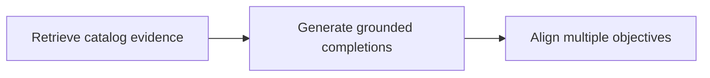
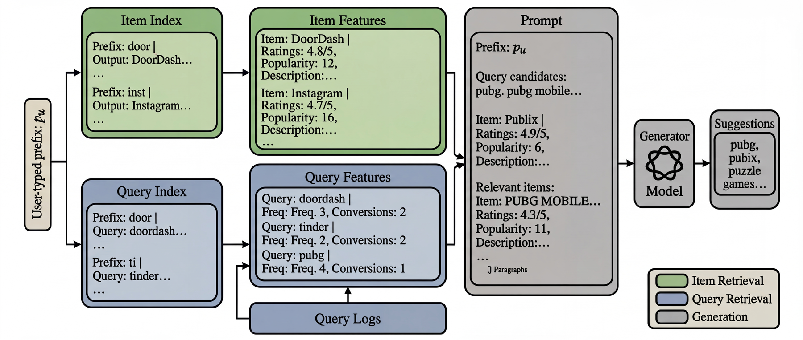

# Unifying Ranking and Generation in Query Auto-Completion via Retrieval-Augmented Generation and Multi-Objective Alignment

<!-- source-sha256: 3ba58c729fb5f3903663c27583cff0b8645c6f0c06db1f31b6bec33022805b52 -->

[简体中文](README.md)

> Core public-data mechanism.

## Paper information

| Field | Details |
|---|---|
| Paper | [Paper or original source](https://arxiv.org/abs/2602.01023) |
| Institution | Apple. |
| First public release | 2026-02-01 (arXiv v1) |
| Author code | No official author code linked by the paper as checked on 2026-08-24. |
| Local adapter or method key | `rag-qac` |
| Local reproduction code | [`src/auto_research/reproductions/rag_qac/`](https://github.com/daiwk/auto-research/tree/main/src/auto_research/reproductions/rag_qac/) |

## Paper method and evidence

Retrieve completion evidence from a searchable catalog. SFT and DPO align relevance, safety, engagement, catalog/context grounding and diversity.



<!-- paper-figure:start -->
### Original paper figure

[](https://arxiv.org/html/2602.01023v4/figures/figure2.jpeg)

Figure shows evidence retrieval and multi-objective alignment. From the [original paper](https://arxiv.org/abs/2602.01023); copyright remains with the authors.
<!-- paper-figure:end -->

### Core equation

$$
R=\sum_k w_kR_k,\quad L=L_{SFT}+\lambda L_{DPO}
$$

### Reported results

Section 7/Table 3 reports **suggestions taken +3.46%** on 10% production traffic; not comparable to local ranking.

## Local reproduction

MovieLens-100K, 220 users/360 items, same split/catalog/seed 42: shared transition+content baseline versus independent mechanism. NDCG@10 **0.0540→0.0516 (-4.48%)**, Hit@10 **0.1091→0.1045**. Validation selects only blend weight. [Metrics](metrics/public-seed42.json). No private logs, production models, bucketing or serving. Public proxies cannot establish online lift.

```bash
auto-research reproduce --paper rag-qac --dataset-dir data --seed 42
```
