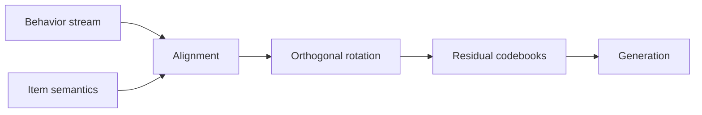
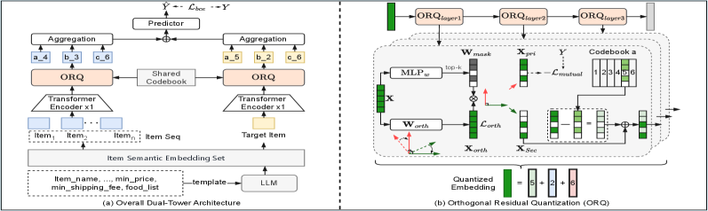

# DOS: Dual-Stream Orthogonal Semantic IDs

<!-- source-sha256: 956781297d29eede8e0514ac368424dfa6cb21429ace668cad240d709a6cc402 -->

[简体中文](README.md)

> Collaborative/semantic streams, orthogonal rotation, and residual quantization execute.

## Paper information

| Field | Value |
| --- | --- |
| Paper | [arXiv 2602.04460](https://arxiv.org/abs/2602.04460) |
| Affiliations | Meituan |
| First public release | 2026-02-04 (arXiv v1) |
| Authors' code | No official author code linked as of 2026-08-09. |
| Adapter / method | `dos` |
| Local code | [`src/auto_research/reproductions/dos/`](https://github.com/daiwk/auto-research/tree/main/src/auto_research/reproductions/dos/) |

## Original paper

### Background and contribution

Content-only codebooks may not match generative recommendation. Align behavior and item semantics, then separate primary and secondary signals with constrained orthogonal rotation before residual quantization.



<!-- paper-figure:start -->
### Key figure from the paper

[](https://ar5iv.labs.arxiv.org/html/2602.04460/assets/x1.png)

Original Figure 1: DOS. From the [paper](https://arxiv.org/abs/2602.04460); copyright belongs to the authors. Not a local result.
<!-- paper-figure:end -->

### Core mechanism

$$
X_{\mathrm{orth}}=XW,\qquad
\mathcal L_{\mathrm{orth}}=\lVert W^\top W-I\rVert_F^2,\qquad
r_{\ell+1}=r_\ell-e_{c_\ell}.
$$

### Paper results

A one-week trial on 30% of Meituan traffic reported +1.15% revenue and deployment to hundreds of millions.

## Local reproduction

Compare unrotated content/collaborative ensemble and Procrustes alignment with three-level ORQ: NDCG@10 0.03540→0.03938 (+11.26%). Rotation error is `6.67e-15`; [results](metrics/movielens-seed42.json).

```bash
auto-research reproduce --paper dos --dataset-dir data --seed 42
```

## Reproduction limits

Public genres and co-occurrences substitute for private LLM item vectors and the generator; not comparable with revenue.
