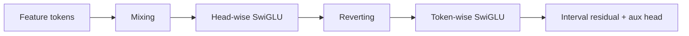
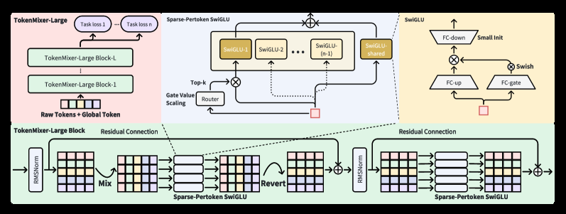

# TokenMixer-Large: scaling token mixing for industrial fine ranking

<!-- source-sha256: 81c61f47eec75eefb1d2f148ce27b89eb793a71b6c7ab72c27366b47537907e3 -->

[简体中文](README.md)

> **Fidelity: full core path.** The backbone, interval residuals, and intermediate auxiliary loss are trained, at reduced scale.

## Paper information

| Field | Details |
|---|---|
| Paper | [arXiv 2602.06563](https://arxiv.org/abs/2602.06563) |
| Organization | ByteDance |
| First public release | 2026-02-06 (arXiv v1) |
| Authors' code | The paper did not supply official or author code when checked on 2026-08-09. |
| Adapter / method | `tokenmixer-large` |
| Local reproduction code | [`src/auto_research/reproductions/tokenmixer_large/`](https://github.com/daiwk/auto-research/tree/main/src/auto_research/reproductions/tokenmixer_large/) |

## Original paper

### Motivation and method

TokenMixer-Large applies parameter-free mixing to candidate and multidomain feature tokens, then head-wise SwiGLU. After reverting the mix it applies token-wise SwiGLU. Interval residuals and intermediate supervision stabilize scaling of deep fine-ranking models.



<!-- paper-figure:start -->
### Key figure from the paper

[](https://ar5iv.labs.arxiv.org/html/2602.06563/assets/x1.png)

> **Figure 1:** Core architecture, modules, and their connections. From the [original paper](https://arxiv.org/abs/2602.06563); copyright remains with the authors.
<!-- paper-figure:end -->

### Core equations

$$
X'=\operatorname{Revert}(\operatorname{SwiGLU}_{head}(\operatorname{Mix}(X))),
\qquad X_{\ell+1}=X_\ell+\operatorname{SwiGLU}_{token}(X').
$$

### Paper results

E-commerce orders +1.66%, preview-payment GMV per person +2.98%, ads ADSS +2.0%, and livestream revenue +1.4%.

## Local reproduction

On MovieLens 100K, TokenMixer-Large and `rankmixer_dense` share dimensions, layer count, negative sampling, and training steps.

> **Local comparison:** Against same-protocol RankMixer dense, TokenMixer-Large increases NDCG@10 from 0.00385 to 0.00414, or +7.54% relative; see `metrics/movielens-100k-seed42.json`.

```bash
auto-research reproduce --paper tokenmixer-large --dataset-dir data --seed 42
```
