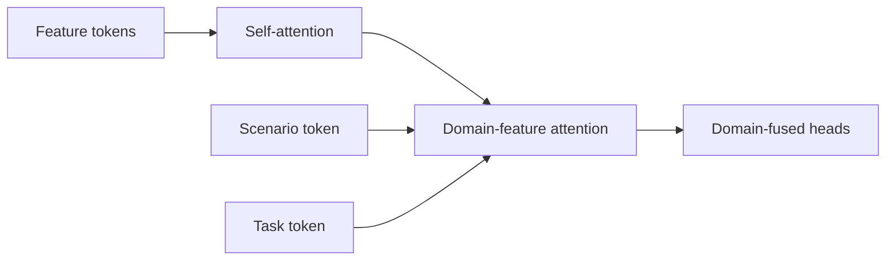
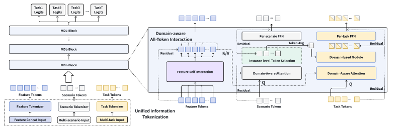

# MDL: Unifying Multi-Distribution Learning with Tokens

<!-- source-sha256: c5ba0eaea8a8d891d080f44097238cf36323920d11ed825f939214090f932cfd -->

[简体中文](README.md)

> **Local core-mechanism evidence.** Paper outcomes and local results are separate.

## Paper information

| Field | Value |
| --- | --- |
| Paper | [arXiv 2602.07520](https://arxiv.org/abs/2602.07520) |
| Affiliations | ByteDance / Douyin |
| First public release | 2026-02-07 (arXiv v1) |
| Authors' code | No official author code linked as of 2026-08-09. |
| Adapter / method | `mdl` |
| Local code | [`src/auto_research/reproductions/mdl/`](https://github.com/daiwk/auto-research/tree/main/src/auto_research/reproductions/mdl/) |

## Original paper

### Background and contribution

Shallow gates underuse shared parameters for multiple scenarios and tasks. Represent features, scenarios, and tasks as tokens and combine feature self-attention, domain-feature attention, and fused heads.



<!-- paper-figure:start -->
### Key figure from the paper

[](https://ar5iv.labs.arxiv.org/html/2602.07520/assets/x1.png)

Original Figure 1: MDL. From the [paper](https://arxiv.org/abs/2602.07520); copyright belongs to the authors. Not a local result.
<!-- paper-figure:end -->

### Core mechanism

$$
A_{d,f}=\operatorname{softmax}\left(\frac{Q_dK_f^\top}{\sqrt d}\right),
\qquad
h_{d,t}=\operatorname{Agg}(A_{d,f}V_f,e_d,e_t).
$$

### Paper results

Douyin online LT30 +0.0626%, query rewrite rate −0.3267%, covering hundreds of millions of users.

## Local reproduction

Shared nontokenized ranker versus 19 feature, 19 scenario, and 2 task tokens: NDCG@10 0.03540→0.04012 (+13.34%), but head share +73.43%. [Metrics](metrics/movielens-seed42.json).

```bash
auto-research reproduce --paper mdl --dataset-dir data --seed 42
```

## Reproduction limits

Genre/next-item proxies do not reproduce production scale, labels, or serving. Keep the increased head bias.
