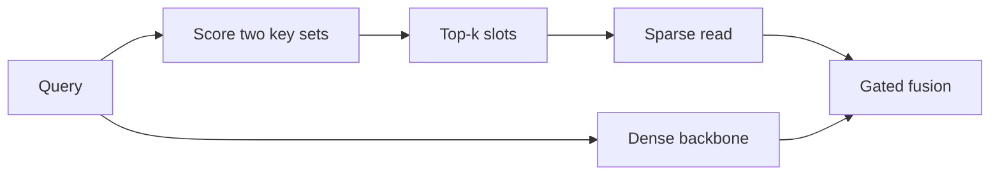
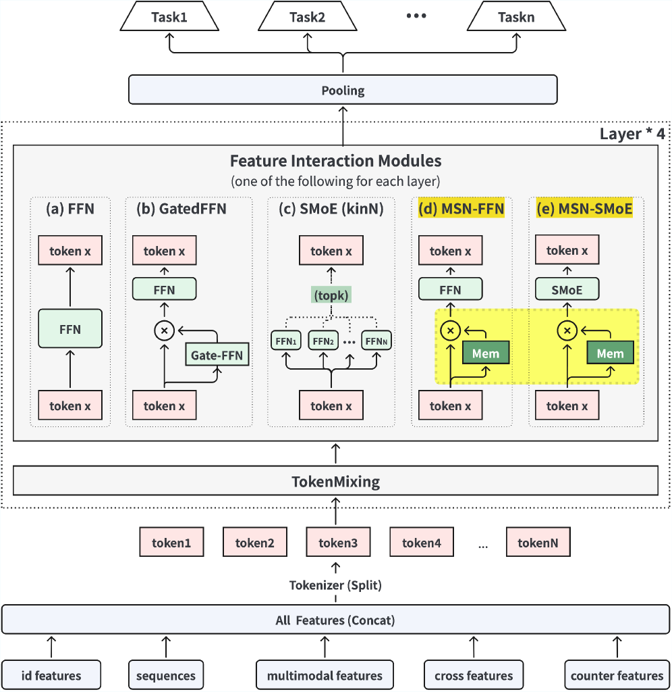

# MSN: Sparse Memory for Industrial Search Ranking

<!-- source-sha256: 80348f664a8b01aef56b22dfa8c75e659bb3faf79aaeb0bc9145d0e0d2db49cd -->

[简体中文](README.md)

> **Core-mechanism reproduction.** Product-key memory, sparse top-k reads, and gated backbone fusion execute.

## Paper information

| Field | Value |
| --- | --- |
| Paper | [arXiv 2602.07526](https://arxiv.org/abs/2602.07526) |
| Affiliations | ByteDance / Douyin Search |
| First public release | 2026-02-07 (arXiv v1) |
| Authors' code | No official author code linked as of 2026-08-09. |
| Adapter / method | `msn` |
| Local code | [`src/auto_research/reproductions/msn/`](https://github.com/daiwk/auto-research/tree/main/src/auto_research/reproductions/msn/) |

## Original paper

### Background and contribution

Scale parameters without proportionally increasing ranking computation. Store capacity in two-axis product-key memory, retrieve a few slots per query, and gate with a dense backbone.



<!-- paper-figure:start -->
### Key figure from the paper

[](https://ar5iv.labs.arxiv.org/html/2602.07526/assets/x3.png)

Original Figure 3: sparse memory architecture. From the [paper](https://arxiv.org/abs/2602.07526); copyright belongs to the authors. Not a local result.
<!-- paper-figure:end -->

### Core mechanism

$$
(i,j)\in\operatorname{TopK}(q^\top k_i^{(1)}+q^\top k_j^{(2)}),\quad
h'=g(q)m_{ij}+(1-g(q))h.
$$

### Paper results

Douyin Search production reports active days +0.0503%, watch time +0.2958%, and finish rate +0.2071%.

## Local reproduction

Build two axes from public genres and write interaction transitions as values. Read four slots. Against a dense transition/content ranker, gated top-k PKM gives NDCG@10 0.03540→0.04240 (+19.78%), in `metrics/movielens-100k-seed42.json`.

```bash
auto-research reproduce --paper msn --dataset-dir data --seed 42
```

## Reproduction limits

This local public-data ranking comparison is not the production result.
