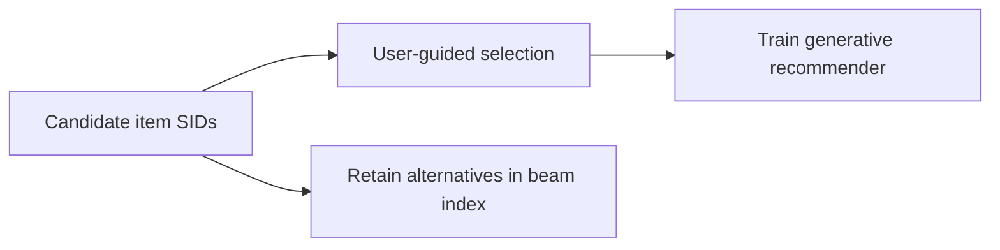
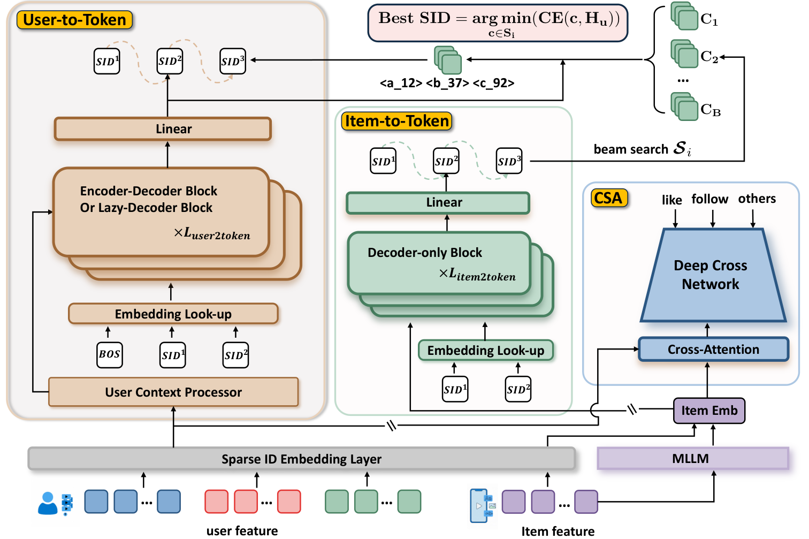

# PIT: Dynamic personalized item tokenization

<!-- source-sha256: a7e77cf62182def754a318a8606c0853789e7068579bd11626df6bb2e74d1e08 -->

[简体中文](README.md)

> Core public-data mechanism, not private production recommendation.

## Paper information

| Field | Details |
|---|---|
| Paper | [arXiv 2602.08530](https://arxiv.org/abs/2602.08530) |
| Institution | Beijing University of Posts and Telecommunications. |
| First public release | 2026-02-09 (arXiv v1) |
| Author code | No public author code found as of 2026-09-05. |
| Local adapter or method key | `pit` |
| Local reproduction code | [`src/auto_research/reproductions/pit/`](https://github.com/daiwk/auto-research/tree/main/src/auto_research/reproductions/pit/) |

## Paper method and evidence

Jointly train tokenizer and generative recommender, selecting the candidate SID with the smallest user-conditioned loss. A one-to-many beam index preserves alternatives under streaming distribution shifts.



<!-- paper-figure:start -->
### Original paper figure

[](https://arxiv.org/html/2602.08530v1/G1.png)

The original figure shows jointly trained tokenization and retrieval. From the [original paper](https://arxiv.org/abs/2602.08530); copyright remains with the authors.
<!-- paper-figure:end -->

### Core equation

$$
z_i^*(u)=\arg\min_{z\in\mathcal B(i)}\mathcal L_{rec}(u,z),\qquad \min_{\theta,\phi}\mathcal L_{token}+\mathcal L_{rec}.
$$

### Reported results

The paper reports a core online business metric **+0.402%**; this is not local evidence.

## Local reproduction

```bash
auto-research reproduce --paper pit --dataset-dir data --seeds 42,43,44
```

Same MovieLens-100K full catalog: NDCG@10 **0.05401→0.05305 (-1.78%)**. [Three-seed metrics, mean, SD and 95% CI](metrics/public-seeds42-44.json). Fixed subset and proxy objective verify the computation only, not private logs, production models, bucketing or serving.
