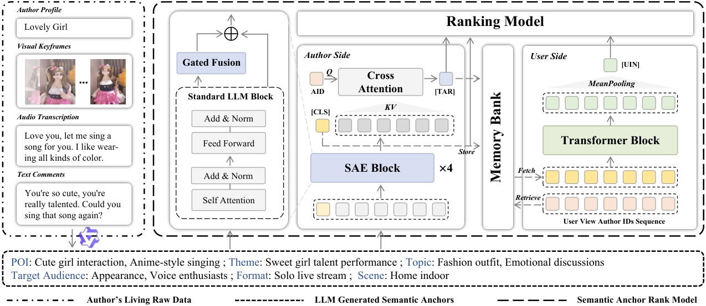

# SARM: LLM-Augmented Semantic Anchor for End-to-End Live-Streaming Ranking

<!-- source-sha256: ebe521812e110cfac9987a3763214e7393d172c7939e4459a2b0b068a3cd4f69 -->

[简体中文](README.md)

> **Fidelity: core mechanism.** Paper online outcomes, local public-data results, and omissions are reported separately.

## Paper information

| Field | Details |
|---|---|
| Paper | [arXiv 2602.09401](https://arxiv.org/abs/2602.09401) |
| Organization | Institute of Information Engineering, CAS / Kuaishou |
| First public release | 2026-02-10 (arXiv v1) |
| Authors' code | The paper did not provide official or author code when checked on 2026-08-24. |
| Adapter / method | `sarm` |
| Local reproduction code | [`src/auto_research/reproductions/sarm/`](https://github.com/daiwk/auto-research/tree/main/src/auto_research/reproductions/sarm/) |

## Original paper

### Motivation and method

An offline MLLM generates livestream semantic anchors, which a lightweight SAE injects into end-to-end ranking. Asymmetric deployment updates only the ranker online to avoid MLLM latency.


<!-- paper-figure:start -->
### Key figure from the paper

[](https://arxiv.org/html/2602.09401v1/model.png)

> **Figure 2:** Core architecture, modules, and connections. From the [original paper](https://arxiv.org/abs/2602.09401); copyright remains with the authors.
<!-- paper-figure:end -->

### Core equations

$$
h_a=SAE(tokens(a)),\quad s=Rank(h_{id},h_a,h_u)
$$

### Paper results

A two-week A/B test reports **watch count +1.19%**, followed by full deployment (Section 4.4, Table 3). The private paper protocol is not directly comparable with local MovieLens measurements.

## Local reproduction

> **Local comparison:** The baseline is the shared transition + content scorer. The treatment adds only sarm on the same users, items, full-catalog candidates, and seed.

MovieLens-100K, 220 users and 360 items, seed 42: NDCG@10 0.0540 → **0.0782 (+44.74%)**; Hit@10 0.1091 → 0.1273. Validation selects mixture weights only; the test set is not used for tuning.

```bash
auto-research reproduce --paper sarm --dataset-dir data --seed 42
```

See the [fixed metrics](metrics/public-seed42.json).

## Reproduction boundaries

The core mechanism runs on MovieLens-100K with the same split, fixed full-catalog candidates, and seed. Private features, the production foundation model, and online traffic are unavailable. The implementation has independent model state and scoring and retains negative results. Local changes and paper A/B gains are reported separately.
