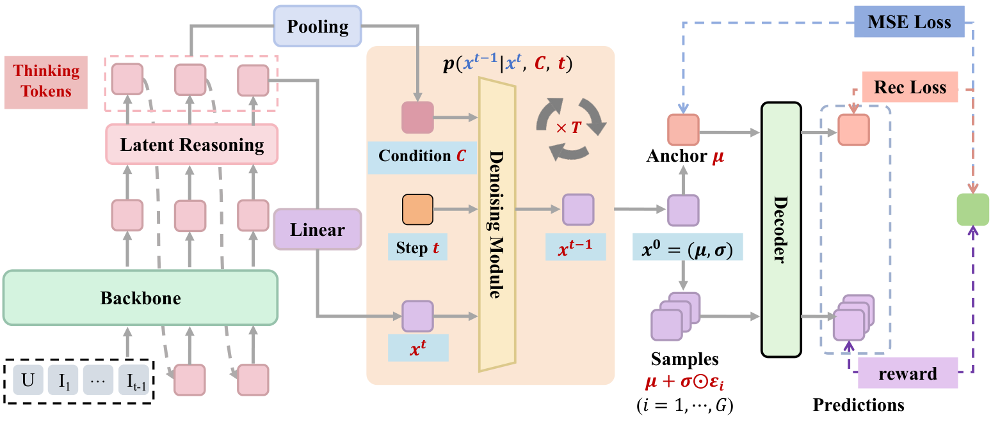

# DiffuReason: Bridging Latent Reasoning and Generative Refinement for Sequential Recommendation

<!-- source-sha256: 96418137398969292da6baa6c6c6759c6a916d6609608a4f5cab496c9241bc30 -->

[简体中文](README.md)

> **Fidelity: core mechanism.** Paper online outcomes, local public-data results, and omissions are reported separately.

## Paper information

| Field | Details |
|---|---|
| Paper | [arXiv 2602.09744](https://arxiv.org/abs/2602.09744) |
| Organization | Tencent |
| First public release | 2026-02-10 (arXiv v1) |
| Authors' code | The paper did not provide official or author code when checked on 2026-08-24. |
| Adapter / method | `diffureason` |
| Local reproduction code | [`src/auto_research/reproductions/diffureason/`](https://github.com/daiwk/auto-research/tree/main/src/auto_research/reproductions/diffureason/) |

## Original paper

### Motivation and method

Thinking Tokens form continuous latent intent. Diffusion denoising refines conflicting interests step by step; GRPO aligns continuous generation with discrete ranking rewards end to end.


<!-- paper-figure:start -->
### Key figure from the paper

[](https://arxiv.org/html/2602.09744v2/diffureason.png)

> **Figure 1:** Core architecture, modules, and connections. From the [original paper](https://arxiv.org/abs/2602.09744); copyright remains with the authors.
<!-- paper-figure:end -->

### Core equations

$$
z_{t-1}=\mu_\theta(z_t,h)+\sigma_t\epsilon,\quad J=\mathbb E[A\log\pi_\theta]
$$

### Paper results

Online ad consumption rises **+1.15%** with 20% traffic for five days (Section 4.7). The private paper protocol is not directly comparable with local MovieLens measurements.

## Local reproduction

> **Local comparison:** The baseline is the shared transition + content scorer. The treatment adds only diffureason on the same users, items, full-catalog candidates, and seed.

MovieLens-100K, 220 users and 360 items, seed 42: NDCG@10 0.0540 → **0.0505 (-6.50%)**; Hit@10 0.1091 → 0.1045. Validation selects mixture weights only; the test set is not used for tuning.

```bash
auto-research reproduce --paper diffureason --dataset-dir data --seed 42
```

See the [fixed metrics](metrics/public-seed42.json).

## Reproduction boundaries

The core mechanism runs on MovieLens-100K with the same split, fixed full-catalog candidates, and seed. Private features, the production foundation model, and online traffic are unavailable. The implementation has independent model state and scoring and retains negative results. Local changes and paper A/B gains are reported separately.
