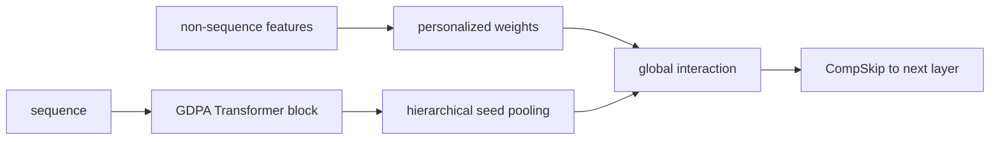
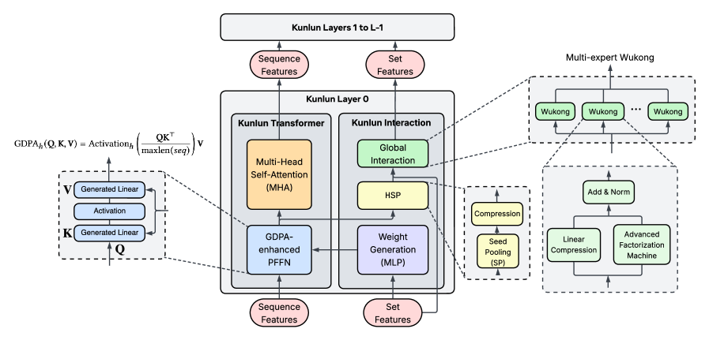

# Kunlun: a unified deep architecture for very large-scale recommendation

<!-- source-sha256: f79a3e84e3f76812c7471e57e486add538e36cd5b0a93907ccd907d478417592 -->

[简体中文](README.md)

> **Fidelity: core mechanism.** Executes GDPA, hierarchical seed pooling, expert routing, and CompSkip, not Meta Ads model scale.

## Paper information

| Field | Details |
|---|---|
| Paper | [arXiv 2602.10016](https://arxiv.org/abs/2602.10016) |
| Organization | Meta |
| First public release | 2026-02-10 (arXiv v1) |
| Authors' code | The paper did not provide official or author code when checked on 2026-08-09. |
| Adapter / method | `kunlun` |
| Local reproduction code | [`src/auto_research/reproductions/kunlun/`](https://github.com/daiwk/auto-research/tree/main/src/auto_research/reproductions/kunlun/) |

## Original paper

### Motivation and method

Traditional ads models optimize sequence towers, dense crosses, and system parallelism separately, so gains saturate as scale grows. Kunlun pairs a Transformer Block with an Interaction Block at each layer. GDPA/PFFN model sequences, HSP summarizes sequence seeds, and Global Interaction exchanges sequence and non-sequence information. CompSkip and expert parallelism maintain deep-training stability and throughput.



<!-- paper-figure:start -->
### Key figure from the paper

[](https://arxiv.org/html/2602.10016v3#S1.F1)

> **Figure 1:** The layerwise pairing of Kunlun Transformer and Interaction Blocks. From the [original paper](https://arxiv.org/abs/2602.10016); copyright remains with the authors.
<!-- paper-figure:end -->

### Core equations

GDPA multiplies content attention by a learned gate; CompSkip controls deep residual connections:

$$
A=\operatorname{softmax}(QK^\top/\sqrt d+\log\sigma(G)),\qquad h_{l+1}=\alpha h_l+(1-\alpha)F_l(h_l).
$$

### Paper results

- Deployed on principal Meta Ads models, with topline `+1.2%`.
- MFU rises from `17%` to `37%`; overall scaling efficiency is about `2×`.

## Local reproduction

> **Local comparison:** The baseline is a shallow transition-content ranker and the treatment is Kunlun's compact core. NDCG@10 is `-5.25%` relative.

A four-layer compact core against the same baseline yields Hit@10 `+4.17%`, NDCG@10 `-5.25%`, fresh Hit@10 `+50%`, and head share `-6.12%`. Diversity proxies improve but ranking quality is unstable. See the [metrics](metrics/movielens-100k-seed42.json).

```bash
auto-research reproduce --paper kunlun --dataset-dir data --seed 42
```

## Reproduction boundaries

Local execution checks operators and information flow, without Meta Ads private data, trillion-parameter scale, expert parallelism, or hardware MFU comparisons.
